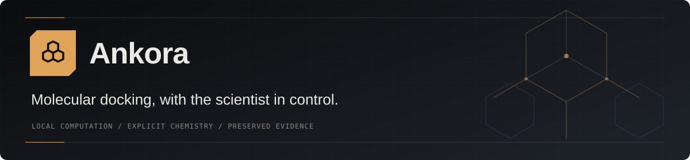
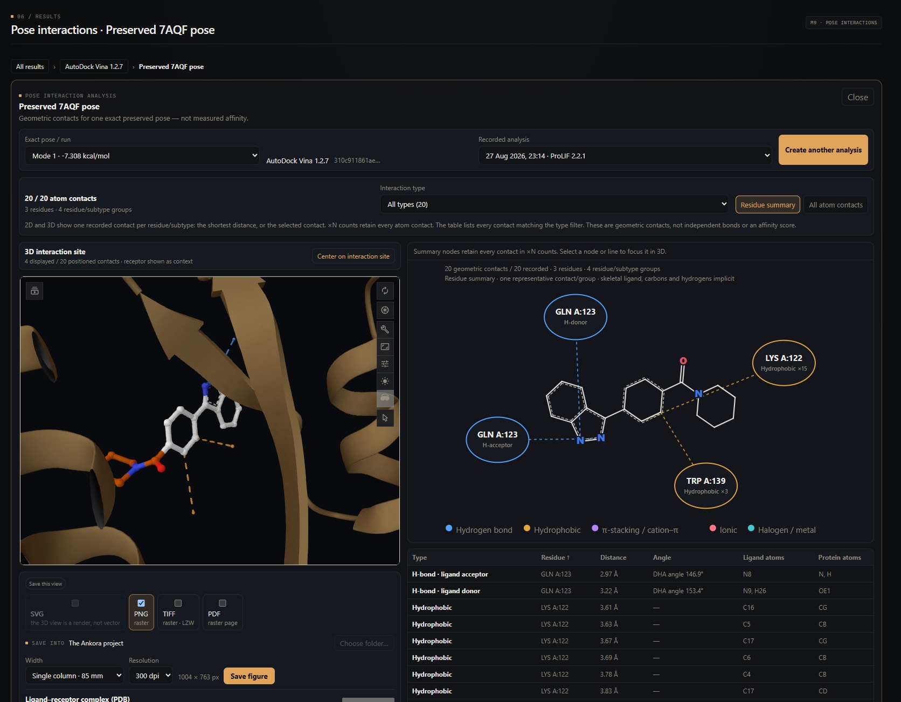
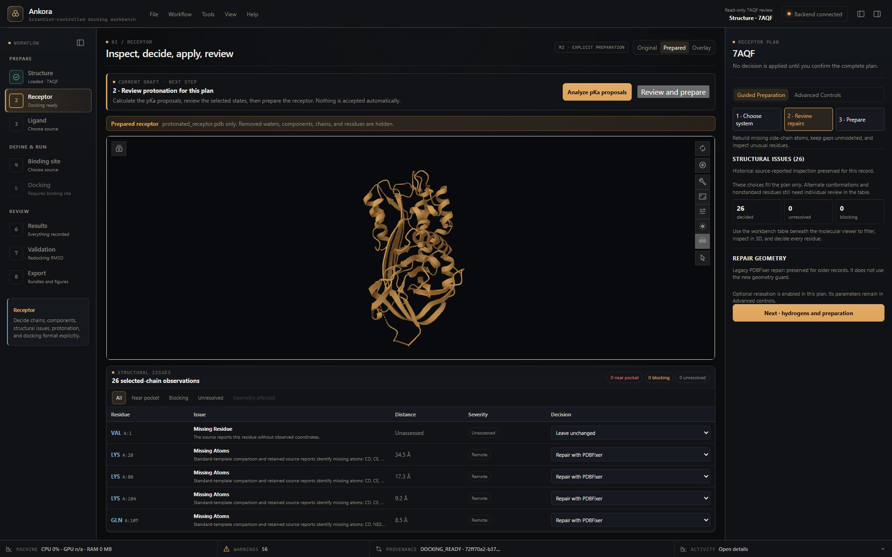
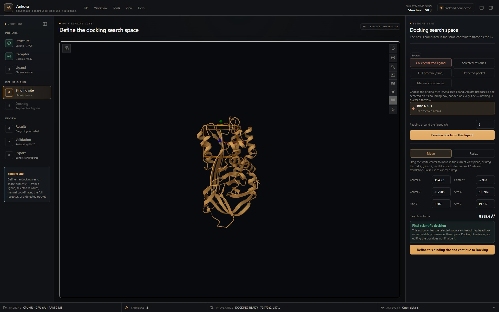

<p align="center">
  
</p>

# Ankora

[](https://github.com/Olascoaga/Ankora/actions/workflows/ci.yml)
[](#installation)
[](#installation)
[](LICENSE)

**Molecular docking, with the scientist in control.**

Ankora is an open-source desktop workbench for molecular docking and virtual
screening. Go from a structure and a compound library to inspectable poses,
interaction diagrams and exportable evidence—without stitching together
separate command-line tools.

Chemical decisions stay visible. Imported files stay unchanged. Every derivative
and calculation carries its inputs, parameters, tool identity and raw outputs.

**[Official website](https://olascoaga.github.io/ankora-website/) · [User guide](docs/USER_GUIDE.md) · [Illustrated PDF](docs/Ankora-User-Guide.pdf) · [Installation](#installation) · [Scientific evidence](#scientific-validation-status) · [For developers](docs/DEVELOPMENT.md)**

[](docs/images/readme-obsidian-interactions.jpg)

*Current development interface, replaying a preserved
7AQF analysis read-only: 20 recorded atomic contacts, not a new calculation.
Contacts describe geometry—not measured affinity. [Capture provenance](docs/images/README.md).*

## From structure to evidence

| Workspace | What you can do |
| --- | --- |
| **Structure** | Import PDB/mmCIF, fetch from RCSB or AlphaFold DB, and inspect chains, components and structural issues. |
| **Receptor** | Follow guided chain, component and structural-issue decisions; review protonation proposals, then create receptor PDBQT. Advanced controls and exact failure evidence remain available. |
| **Ligands** | Inspect one compound or import multi-molecule SDF/SD-style MOL/SMILES libraries. Review molecular properties, chemical states and filtering before independent 3D preparation and minimization. |
| **Binding site** | Define an editable search box from the full protein, a reference ligand, selected residues, manual coordinates or a P2Rank pocket. Move and resize it directly in the viewer. |
| **Docking** | Run a single ligand or a prepared library, with explicit engine settings, bounded resource allocation, live molecule-level progress and preserved failures. |
| **Results** | Browse campaigns, sort compounds, inspect poses or clusters, compare rankings without combining incompatible scores, and move selected campaigns to recoverable Trash. |
| **Validation** | Create a saved redocking validation from a completed individual Vina or AutoDock4 CPU/GPU result and its compatible crystallographic reference. Inspect sampling and ranking separately with symmetry-aware, in-place heavy-atom RMSD. |
| **Export** | Save figures, exact ligand–receptor PDB complexes, record-derived Methods and portable screening campaign bundles. |

### Prepare libraries deliberately

- Preview **Lipinski, Veber, Ghose, Muegge and QED**, with **PAINS/Brenk**
  alerts and duplicate findings. Rules and alerts inform an explicit selection;
  they do not establish biological activity.
- Inspect molecular weight, SMILES, charge, stereochemistry and components.
  Resolve ambiguous chemistry through visible choices, including optional
  bounded protonation/tautomer microstate enumeration.
- Generate independent **ETKDGv3 conformers**, minimize with **MMFF**, and
  prepare converged structures with **Meeko**. Keep the imported reference intact.
- Process independent molecules with bounded multicore workers. Docking shares
  an explicit CPU/GPU/memory budget instead of silently oversubscribing the machine.

### Choose the engine, keep its meaning

| Engine | Execution | Important distinction |
| --- | --- | --- |
| **AutoDock Vina 1.2.7** | CPU · single ligand or library | Vina poses and scores retain their own scoring scale. |
| **AutoDock4 4.2.6** | CPU · single ligand or library | AutoGrid4 maps are preserved and reusable; review native DLG clusters and runs. |
| **AutoDock-GPU 1.6** | Optional OpenCL GPU · single ligand or library | Uses the AutoDock4 scoring family with a different search protocol. GPU runs are not assumed bitwise reproducible. |

GNINA is deferred, not a supported engine in this beta. Scores from different
scoring functions are not interchangeable, and a lower docking score is not
proof of stronger experimental affinity.

## A workbench you can inspect

<table>
  <tr>
    <td width="50%"><a href="docs/images/readme-receptor.jpg"></a></td>
    <td width="50%"><a href="docs/images/readme-binding-site.jpg"></a></td>
  </tr>
  <tr>
    <td><strong>Inspect before transforming.</strong><br>Viewer-linked issues and explicit receptor decisions.</td>
    <td><strong>Define the search space.</strong><br>A visible, editable box before any docking calculation.</td>
  </tr>
</table>

*Real current-interface captures, not interface mockups: a saved 7AQF receptor
reopened for review, and a transient box preview around RV2 A:401. No preparation
or docking was rerun. Open an image to see it at full resolution.*

Activity, tool readiness, warnings and provenance stay accessible in one place.
Independent project workspaces keep separate evidence, while the dependency
graph makes stale inputs and their affected derivatives visible.

### Validate the pose, not just its score

Redocking validation measures **existing saved poses**; it does not start another
docking run. Select a completed individual result, its compatible original
crystallographic reference and an explicit RMSD threshold. Ankora verifies
preserved inputs and coordinate identity before saving the validation.

Sampling (was a reference-like pose found?) and ranking (was it ranked first?)
are separate outcomes. Poses are **not superposed** before placement is judged.
Library campaigns are not individual redocking inputs, and a successful
redocking result does not validate prospective affinity prediction.
See the [current workflow correction](docs/validation/REDOCKING_WORKFLOW_2026-10-20.md).

## Installation

**Current distribution: private beta for Windows 11 x64.** The source is public;
there is not yet a public installer release. Invited testers receive the complete
installer and its checksum through the beta distribution channel.

**Which version am I seeing?** This README describes current source development.
Compare your installer/build identity with the [changelog](CHANGELOG.md) when
reporting a bug; source changes do not update an installed beta automatically.

1. Obtain the reviewed beta installer and verify its SHA-256 checksum.
2. Run the installer and follow the setup steps.
3. Open Ankora, check **Scientific tools**, and start with the
   [7AQF/RV2 walkthrough](docs/USER_GUIDE.md).

**No separate Python, Conda, Java or scientific-tool installation is required.**
The complete installer includes the scientific Python runtime, receptor/ligand
preparation tools, supported docking engines, P2Rank, a private Java runtime and
offline WebView2. RCSB/AlphaFold downloads require internet access; preparation
and docking execute locally.

GPU docking additionally needs compatible OpenCL hardware and its vendor
driver. Ankora does not install GPU drivers or silently replace CPU execution.
Linux and macOS are not accepted release platforms yet.

The beta installer is **unsigned**. Follow your institution's software policy;
do not disable system security to install it. Signing, broader clean-machine
acceptance and hardware coverage remain public-release gates. See the
[latest installer acceptance record](docs/validation/PRIVATE_BETA_INSTALLER_2026-10-15.md).

## Traceability is part of the workflow

- **Immutable sources:** preparation creates derivatives rather than overwriting
  imported coordinates or compounds.
- **Recorded execution:** commands, parameters, versions, executable hashes,
  raw outputs and molecule-level errors travel with the result.
- **Honest recovery:** interrupted attempts remain visible; a confirmed retry
  receives a new identity. Stale dependencies are not presented as current.
- **Connected review:** 2D, 3D and tables refer to the same preserved pose and
  contact set. Summary counts retain the underlying atomic contacts.
- **Local computation:** no telemetry or cloud upload. The backend binds only
  to localhost; public structure retrieval is an explicit network action.

<!-- BEGIN GENERATED VALIDATION STATUS -->
## Scientific validation status

Ankora implements the M1-M9 workflow. Frozen completed evidence exists for PIK3CD 6OCO / M5V; other cases and known gaps remain visible in the [public validation status](docs/validation/VALIDATION_STATUS.md). This evidence does not yet establish prospective screening performance, affinity prediction, biological activity, or cross-target generality.
<!-- END GENERATED VALIDATION STATUS -->

Completed evidence is not synonymous with a successful recovery: failures,
near misses and ranking limitations remain in the records. The retrospective
[LIT-PCBA primary screening report](docs/validation/LIT_PCBA_VINA_PRIMARY_RESULTS_2026-09-28.md)
and [metrics record](docs/validation/LIT_PCBA_VINA_PRIMARY_METRICS_2026-09-28.md)
provide additional bounded evidence, not a claim of universal screening performance.

The illustrated 7AQF manual separates fresh ligand preparation, Vina docking
and interaction analysis from historical receptor/redocking records. It does
not imply a matched-input comparison between engines.

## Documentation

| Start here | Purpose |
| --- | --- |
| [Illustrated user guide](docs/USER_GUIDE.md) · [PDF](docs/Ankora-User-Guide.pdf) | Full 7AQF/RV2 walkthrough, with 19 real figures and scientific cautions. |
| [Public validation status](docs/validation/VALIDATION_STATUS.md) | Frozen cases, completed evidence and known gaps. |
| [Development and packaging](docs/DEVELOPMENT.md) | Source setup, scientific environment locks, tests and installer maintenance. |
| [Architecture decisions](docs/architecture/ADR) | Scientific and engineering contracts. |
| [Changelog](CHANGELOG.md) | Implemented changes and their verification boundaries. |

## Build from source

For contributors—not required for installing the beta. On a Windows development
machine with the [native prerequisites](docs/DEVELOPMENT.md#prerequisites):

```powershell
git clone https://github.com/Olascoaga/Ankora.git
cd Ankora
conda env create -f environment.yml
conda activate ankora-dev
.\scripts\bootstrap.ps1 -PythonEnvironment Conda -ReceptorTools
npm.cmd run tauri:dev
```

Source development also requires configuring the external docking and pocket
tools; the complete installer bundles them for end users. See the
[developer guide](docs/DEVELOPMENT.md) for discovery and the locked release environment.
Run the verification suite with `.\scripts\test.ps1`.

Built with **Tauri 2 / Rust**, **React / TypeScript**, **Mol\*** and a
**Python / FastAPI** scientific backend. The frontend never launches scientific
executables directly.

## Feedback, citation and license

Found a problem? [Open an issue](https://github.com/Olascoaga/Ankora/issues)
with the Ankora version, Windows version, engine and steps to reproduce.
Remove personal paths and confidential compounds from shared evidence.

Created by **Samael Olascoaga**. If you use Ankora in published work, cite the
exact version or commit and the scientific tools used; repository citation
metadata is in [CITATION.cff](CITATION.cff). Exported Methods state what the
campaign records support and flag missing information for review.

Ankora's code is licensed under [MIT](LICENSE). Bundled third-party components
retain their own licenses, notices and corresponding-source obligations;
Ankora's license does not replace theirs.
