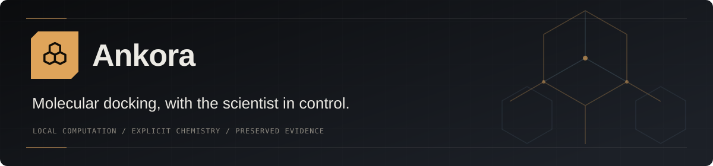
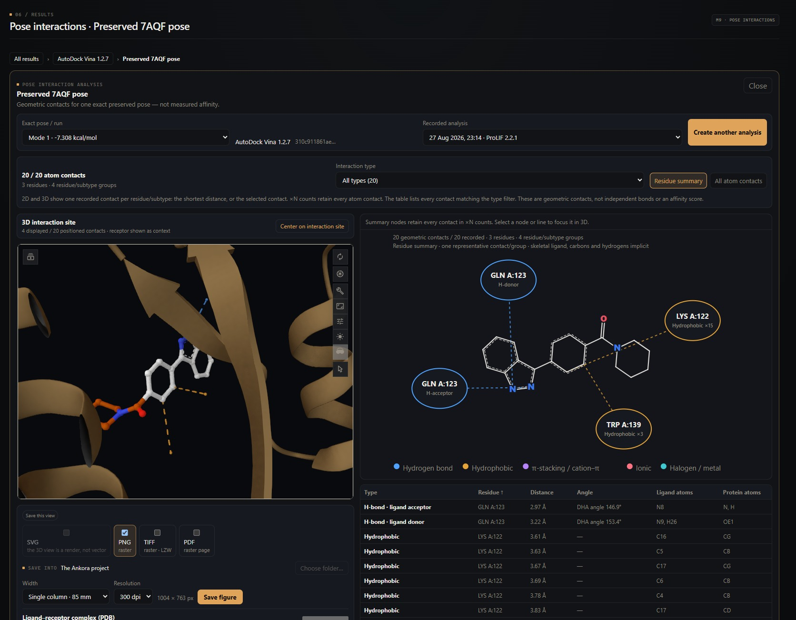
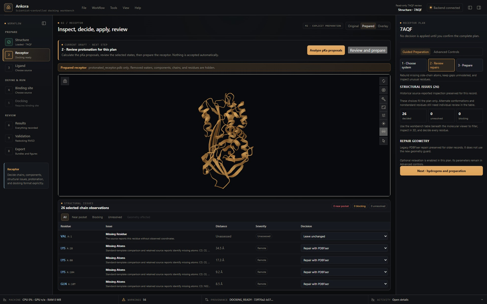
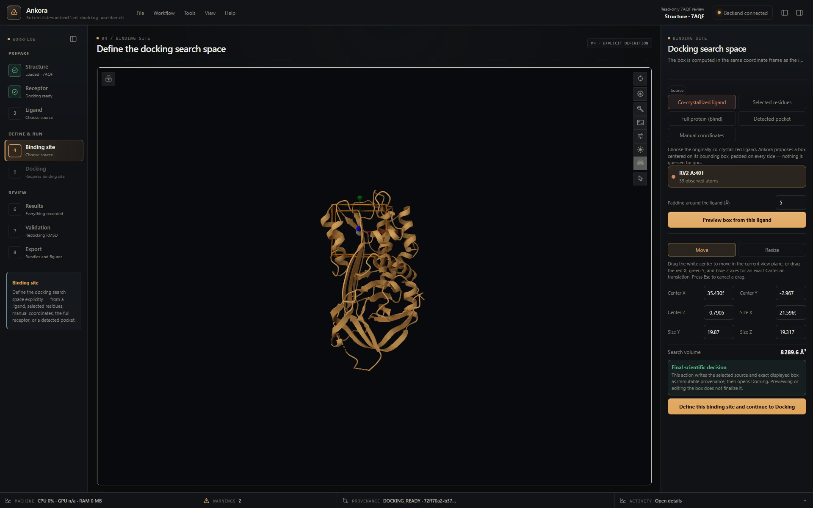

<p align="center">
  
</p>

# Ankora

[](https://github.com/Olascoaga/Ankora/actions/workflows/ci.yml)
[](#installation)
[](#installation)
[](LICENSE)

**Molecular docking, with the scientist in control.**

Ankora is a local-first open-source desktop workbench for molecular docking and
virtual screening on **Windows 11 x64** and **Linux x86\_64**. Go from a crystal
or predicted structure and a compound library to inspectable poses, in-place
redocking verdicts, interaction diagrams, literal `Methods` prose, and portable
campaign bundles—without stitching together opaque scripts or surrendering
chemical decisions to hidden defaults.

Imported structures and libraries stay immutable. Every protonation, repair,
microstate, search-box, and engine choice is explicit, hashed with SHA-256, and
linked to raw tool outputs.

**[Official website](https://olascoaga.github.io/ankora-website/) · [Docs portal](docs/README.md) · [User guide](docs/USER_GUIDE.md) · [Illustrated PDF](docs/Ankora-User-Guide.pdf) · [Platform matrix](docs/product/PLATFORM_STATUS.md) · [Evidence index](docs/validation/INDEX.md) · [Installation](#installation)**

[](docs/images/readme-obsidian-interactions.jpg)

*Current development interface, replaying a preserved
7AQF analysis read-only: 20 recorded atomic contacts, not a new calculation.
Contacts describe geometry—not measured affinity. [Capture provenance](docs/images/README.md).*

## From structure to citable evidence

| Workspace | What you can do |
| --- | --- |
| **Structure** | Import local `PDB`/`mmCIF` or fetch from RCSB PDB and AlphaFold DB; inspect chains, heterogens, waters, alternate locations, and missing atoms before creating any derivative. |
| **Receptor** | Step through guided chain, component, and topology-guarded side-chain repair decisions (`topology_guard_v3`), review `PROPKA`/`PDB2PQR` protonation proposals, and generate `Meeko` receptor `PDBQT` with full failure diagnostics. |
| **Ligands** | Prepare one compound or screen up to 10,000-record `SDF`/`MOL`/`SMILES` libraries with explicit stereochemistry and physiological-pH microstate selection (`ADR-016`), rule/alert evaluation, independent `ETKDGv3`/`MMFF94s` minimization, and `Meeko` `PDBQT` creation. |
| **Binding site** | Define an editable Cartesian box from co-crystallized ligands, selected residues, `P2Rank 2.5.1` pockets, manual coordinates, or acknowledged blind whole-protein coverage—translating and resizing directly in 3D. |
| **Docking** | Execute single-ligand runs or library campaigns across **AutoDock Vina**, **AutoDock4 CPU**, **AutoDock-GPU**, and (on Linux) **GNINA**, governed by a unified CPU/GPU/RAM/VRAM resource arbiter with preserved row-level failures. |
| **Results** | Reopen campaigns across restarts, inspect native Vina modes, AutoDock clusters/runs, or GNINA CNN-ordered poses, compare compatible Vina vs AutoDock4 CPU rankings via Spearman correlation, and manage records with atomic recoverable `Trash`. |
| **Validation** | Compute symmetry-aware, **in-place** heavy-atom RMSD (never superposed) from completed individual Vina, AutoDock4 CPU/GPU, or Linux GNINA jobs against an immutable crystallographic extraction, separating **sampling** from **ranking** verdicts. |
| **Export** | Save publication figures (`SVG`/`PNG`/`TIFF`/`PDF`), exact ligand–receptor `PDB` complexes, record-derived `Methods` sections with DOI-verified citations and explicit `[not recorded: …]` gap markers, and portable ZIP bundles (`Export` format 4). |

### Prepare libraries deliberately

- Preview **Lipinski, Veber, Ghose, Muegge and QED**, alongside **PAINS/Brenk**
  structural alerts and chemical-identity duplicates, before locking an
  immutable selection manifest. Rules and alerts inform explicit curation; they
  do not establish biological activity.
- Enumerate bounded protonation/tautomer candidates (`Dimorphite-DL` / `RDKit`)
  as unranked options and commit one explicit microstate per retained parent.
- Generate independent **ETKDGv3 conformers**, minimize with **MMFF94s**, and
  prepare converged molecules with **Meeko** while keeping imported coordinates
  untouched and retaining non-converged or engine-incompatible molecules in the
  campaign denominator.

### Choose the engine, keep its meaning

| Engine | Platforms & execution | Result model & scientific boundary |
| --- | --- | --- |
| **AutoDock Vina `1.2.7`** | Windows & Linux · CPU single or concurrent worker pool | Pose-native modes ordered by empirical Vina score (`kcal/mol`) with inter-mode RMSD bounds and `27,000 ų` search-volume guardrails. |
| **AutoDock4 `4.2.6` (CPU)** | Windows & Linux · CPU single or library | Native `DLG` clusters and runs over immutable, reusable `AutoGrid4 4.2.6` affinity maps (`14` ligand / `20` receptor atom-type preflight). |
| **AutoDock-GPU `1.6`** | Windows (`OpenCL`) & Linux (`CUDA 12`) · Single or `--filelist` library | Accelerates the AutoDock4 scoring family over shared `AutoGrid4` maps using a stochastic parallel search protocol (not assumed bitwise reproducible). |
| **GNINA `1.3.3`** | **Linux `x86_64` only** · `CPU` or `CUDA 12.8` single or sequential library screening | CNN-ordered poses carrying separate `CNNscore` (`[0, 1]`), `CNNaffinity` (`pK`), `CNN_VS` (`CNNscore × CNNaffinity`) hit prioritization, `rescore` or CUDA-only `refinement`, and built-in `dense_1_3` (1-model default), `default_1_3_ensemble` (3 KD models), and `default1.0` (5 models). Deferred on native Windows. |

Scores from different scoring functions live on incompatible scales and are
**never** averaged or combined into a consensus number, nor is a computational
score proof of experimental affinity. For compatible **AutoDock Vina** and
**AutoDock4 (CPU)** library campaigns sharing the exact receptor, finalized
binding site, and selection manifest, Ankora reports **Spearman rank
correlation (`ρ`) and Top-`N` overlap** without pooling scores; GNINA remains in
its separate CNN catalog family. Under GNINA `refinement`, `minimizedAffinity`
is evaluated on geometry jointly optimized with CNN and empirical gradients and
is explicitly documented as non-independent (`docs/scientific/DOCKING_POLICY.md`).

## A workbench you can inspect

<table>
  <tr>
    <td width="50%"><a href="docs/images/readme-receptor.jpg"></a></td>
    <td width="50%"><a href="docs/images/readme-binding-site.jpg"></a></td>
  </tr>
  <tr>
    <td><strong>Inspect before transforming.</strong><br>Viewer-linked issues and explicit receptor decisions.</td>
    <td><strong>Define the search space.</strong><br>A visible, editable box before any docking calculation.</td>
  </tr>
</table>

*Real current-interface captures, not interface mockups: a saved 7AQF receptor
reopened for review, and a transient box preview around RV2 A:401. No preparation
or docking was rerun. Open an image to see it at full resolution.*

Activity, tool readiness, warnings and provenance stay accessible in one place.
Independent project workspaces keep separate evidence, while the dependency
graph makes stale inputs and their affected derivatives visible.

### Validate the pose, not just its score

Redocking validation measures **existing saved poses**; it does not start another
docking run. Select a completed individual Vina, AutoDock4 CPU/GPU, or Linux
GNINA result, its compatible original crystallographic reference, and an
explicit RMSD threshold. Ankora verifies preserved inputs and coordinate
identity before saving the validation.

Sampling (was a reference-like pose found?) and ranking (was it ranked first, in
the engine's own native pose order?) are separate outcomes. Poses are **not
superposed** before placement is judged. Library campaigns are not individual
redocking inputs, and a successful redocking result does not validate
prospective affinity prediction. See the
[redocking validation policy](docs/scientific/REDOCKING_VALIDATION.md) and
[workflow record](docs/validation/REDOCKING_WORKFLOW_2026-10-20.md).

## Installation

**Current distribution status:** **Windows 11 x64 (`private_beta`)** and **Linux
`x86_64` (`release_candidate`, Ubuntu 24.04 LTS reference)**. The source is
public; there is not yet a signed public installer release on GitHub Releases.
See the machine-verified [platform status matrix](docs/product/PLATFORM_STATUS.md)
for exact artifact sizes, hashes, and open release gates. macOS is out of scope.

**Which version am I seeing?** This README describes current source development.
Compare your package build identity with the [changelog](CHANGELOG.md) when
reporting an issue; source commits do not update an installed build automatically.

**No separate Python, Conda, Java or scientific-tool installation is required**
for packaged end-user distributions:

### Windows 11 x64 — Private Beta (`ADR-024`)

- **Complete offline installer (`Ankora_0.1.0_x64-setup.exe`, `407.16 MiB`):**
  bundles Python `3.12.13`, receptor/ligand preparation tools, `AutoDock Vina
  1.2.7`, `AutoGrid4 / AutoDock4 4.2.6`, `AutoDock-GPU 1.6` (`OpenCL`), `P2Rank
  2.5.1` with private Java `21`, and offline `WebView2`.
- Verify the SHA-256 checksum, install, open **Tools → Scientific tools**, and
  follow the [7AQF/RV2 walkthrough](docs/USER_GUIDE.md).
- The beta installer is **unsigned**; follow your institution's security policy
  and never disable OS protections to install it. See
  [slim installer evidence](docs/validation/PRIVATE_BETA_SLIM_INSTALLER_2026-10-20.md)
  and [full installer acceptance](docs/validation/PRIVATE_BETA_INSTALLER_2026-10-15.md).

### Linux `x86_64` — Release Candidate (`ADR-029`, awaiting bare-metal Gate `D6`)

- **Core double-click package (`Ankora_0.1.0_amd64.deb`, `272.34 MiB`)** for
  Ubuntu 24.04 LTS, Debian, Linux Mint, and Pop!\_OS, or **zero-`sudo` portable
  archive (`Ankora_0.1.0_linux_x86_64.tar.zst`, `313.97 MiB`)** for shared lab
  workstations without administrator rights. Both bundle `WebKitGTK` desktop
  integration, Python `3.12.13`, `Vina 1.2.7`, `AutoGrid4/AutoDock4 4.2.6`,
  multi-arch `CUDA 12` `AutoDock-GPU 1.6`, `Temurin OpenJDK 21`, and `P2Rank
  2.5.1` (`10/10` Core tools offline).
- **Optional 1-click offline GNINA pack (`Ankora_0.1.0_gnina-cuda12-pack.tar.zst`, `2.55 GiB`; `.part01` + `.part02` `< 2 GiB` split on GitHub Releases):**
  contains `gnina 1.3.3` plus `17` redistributable `CUDA 12.8` and `cuDNN 9.25`
  user-space libraries. Import it directly inside **Tools → Scientific tools**
  with zero `sudo`, zero terminal commands, and isolated GNINA-only library
  loading (`11/11` tools ready without restart; persists across `.deb` upgrades).
- **Release boundary:** Clean-room offline execution and RTX 5050 CUDA smoke
  passed under WSL2/WSLg ([`LINUX_OFFLINE_PACKAGE_SMOKE.md`](docs/validation/LINUX_OFFLINE_PACKAGE_SMOKE.md));
  final Linux release acceptance requires executing the 1-command physical
  workstation attestation in [`LINUX_NATIVE_WORKSTATION_PROTOCOL.md`](docs/validation/LINUX_NATIVE_WORKSTATION_PROTOCOL.md)
  (Gate `D6`).

GPU execution on either OS requires compatible hardware and the host OS vendor
driver (`OpenCL` on Windows; `NVIDIA` driver `>= 570.x` recommended for CUDA
12.8 on Linux). Ankora never bundles kernel GPU drivers and never falls back
silently from requested GPU execution to CPU. Public RCSB/AlphaFold fetches
require internet access; all preparation, docking, and analysis run locally.

## Traceability is part of the workflow

- **Immutable sources:** preparation creates derivatives rather than overwriting
  imported coordinates or compounds.
- **Recorded execution:** commands, parameters, versions, executable hashes,
  raw outputs and molecule-level errors travel with the result.
- **Honest recovery:** interrupted attempts remain visible; a confirmed retry
  receives a new identity. Stale dependencies are not presented as current.
- **Connected review:** 2D, 3D and tables refer to the same preserved pose and
  contact set. Summary counts retain the underlying atomic contacts.
- **Local computation:** no telemetry or cloud upload. The backend binds only
  to localhost; public structure retrieval is an explicit network action.

<!-- BEGIN GENERATED VALIDATION STATUS -->
## Scientific validation status

Ankora implements the M1-M9 workflow. Frozen completed evidence exists for PIK3CD 6OCO / M5V; other cases and known gaps remain visible in the [public validation status](docs/validation/VALIDATION_STATUS.md). This evidence does not yet establish prospective screening performance, affinity prediction, biological activity, or cross-target generality.
<!-- END GENERATED VALIDATION STATUS -->

Completed evidence is not synonymous with a successful recovery: failures,
near misses and ranking limitations remain in the records. The retrospective
[LIT-PCBA primary screening report](docs/validation/LIT_PCBA_VINA_PRIMARY_RESULTS_2026-09-28.md)
and [metrics record](docs/validation/LIT_PCBA_VINA_PRIMARY_METRICS_2026-09-28.md)
provide additional bounded evidence, not a claim of universal screening performance.

The illustrated 7AQF manual separates fresh ligand preparation, Vina docking
and interaction analysis from historical receptor/redocking records. It does
not imply a matched-input comparison between engines.

## Documentation

| Start here | Purpose |
| --- | --- |
| [Documentation portal](docs/README.md) | Task-oriented map of every user guide, scientific policy, ADR, and developer manual. |
| [Illustrated user guide](docs/USER_GUIDE.md) · [PDF](docs/Ankora-User-Guide.pdf) | Full `7AQF/RV2` walkthrough with 19 real captures, plus Linux `GNINA 1.3.3` scoring and virtual screening. |
| [Platform & engine status](docs/product/PLATFORM_STATUS.md) | Canonical implementation, offline-packaging, CI, and release-gate matrix across Windows, Linux, and macOS. |
| [Public validation status](docs/validation/VALIDATION_STATUS.md) · [Full 128-record index](docs/validation/INDEX.md) | Frozen reference benchmarks (`6OCO`, `7AQF`), retrospective `LIT-PCBA` screening, and Linux/GNINA engineering smokes. |
| [Scientific policies](docs/scientific/DOCKING_POLICY.md) | Receptor/ligand preparation, multi-engine scoring semantics, in-place redocking, `ProLIF` contacts, and `Methods` reporting. |
| [Windows](docs/DEVELOPMENT.md) & [Linux development](docs/DEVELOPMENT_LINUX.md) | Hash-locked scientific environments, source execution, test suites, and offline installer packaging. |
| [Architecture](docs/architecture/ARCHITECTURE.md) & [ADRs](docs/architecture/ADR) | System boundaries and Architecture Decision Records (`ADR-001`–`ADR-029`). |
| [Changelog](CHANGELOG.md) | Chronological log of verified scientific and engineering changes. |

## Build from source

For contributors—not required for installing packaged distributions. Source
development also requires configuring external docking and pocket tools unless
imported via the Linux GNINA pack; packaged installers bundle Core tools for end
users.

**Windows 11 PowerShell** ([prerequisites & locked setup](docs/DEVELOPMENT.md#prerequisites)):

```powershell
git clone https://github.com/Olascoaga/Ankora.git
cd Ankora
conda env create -f environment.yml
conda activate ankora-dev
.\scripts\bootstrap.ps1 -PythonEnvironment Conda -ReceptorTools
npm.cmd run tauri:dev
```

**Linux `x86_64` Bash — Ubuntu 24.04 LTS / WSL2** ([prerequisites & locked setup](docs/DEVELOPMENT_LINUX.md#2-system-prerequisites-ubuntu-2404-lts--wsl2-with-wslg)):

```bash
git clone https://github.com/Olascoaga/Ankora.git
cd Ankora
conda create -n ankora-dev --file environment/linux-64.conda.lock --yes
conda activate ankora-dev
export PYTHONNOUSERSITE=1
python -m pip install --require-hashes --only-binary=:all: -r requirements/linux-py312.lock
python -m pip install --no-deps --no-build-isolation -e backend
npm ci
npm run tauri:dev:linux
```

Run the Windows verification suite with `.\scripts\test.ps1` or follow the
exact Linux CI verification commands in
[`docs/DEVELOPMENT_LINUX.md`](docs/DEVELOPMENT_LINUX.md#local-test-suite--ubuntu-2404-ci-verify-linux).

Built with **Tauri 2 / Rust** (`WebView2` on Windows, `WebKitGTK` on Linux),
**React / TypeScript**, **Mol\*** and a **Python 3.12 / FastAPI** scientific
backend. The frontend never launches scientific executables directly.

## Feedback, citation and license

Found a problem? [Open an issue](https://github.com/Olascoaga/Ankora/issues)
with the Ankora version or commit, OS and GPU driver version, engine, and steps
to reproduce. Remove personal paths and confidential compounds from shared
evidence.

Created by **Samael Olascoaga** ([ORCID `0009-0008-5522-7938`](https://orcid.org/0009-0008-5522-7938)).
If you use Ankora in published work, cite the exact version or commit and the
scientific tools executed; repository citation metadata is in
[`CITATION.cff`](CITATION.cff). Exported `Methods` sections state only what the
campaign records support and flag missing information explicitly for review.
Manuscript reviewers and readers can verify any exported campaign bundle or folder
without installing Ankora via the standard-library verifier
`python scripts/verify_export_bundle.py <bundle.zip>`.

Ankora's code is licensed under [MIT](LICENSE). Bundled third-party components
retain their own licenses, notices and corresponding-source obligations;
Ankora's license does not replace theirs.
