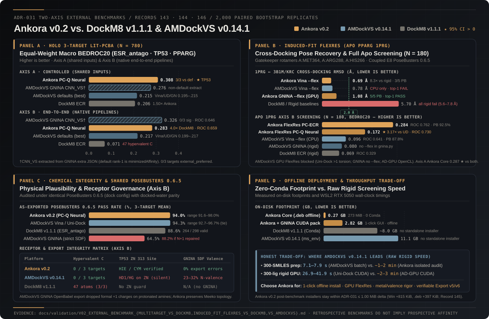
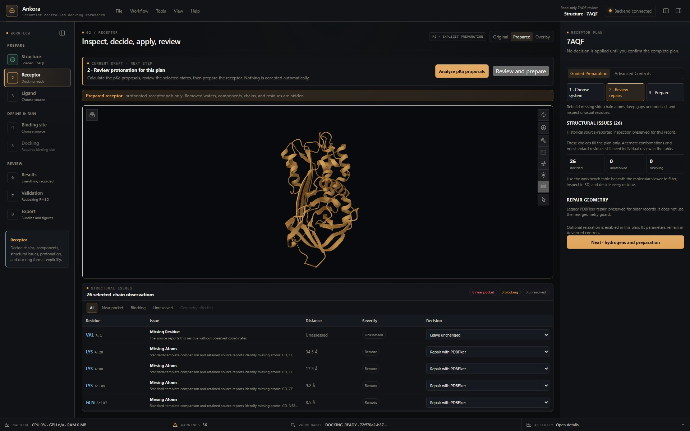
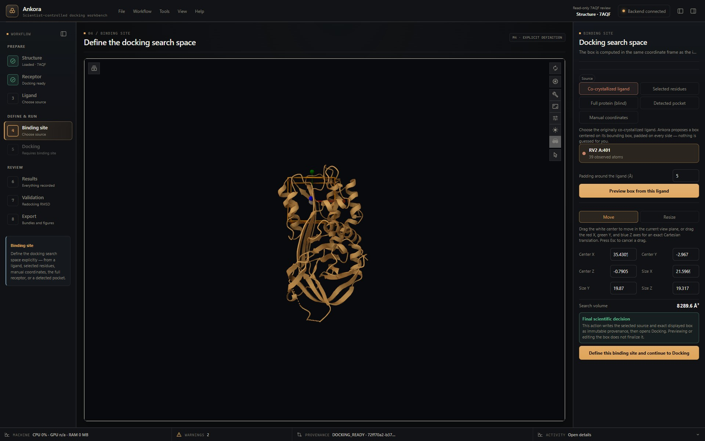

<p align="center">
  
</p>

<h1 align="center">Ankora</h1>

<p align="center">
  <strong>Molecular docking, with the scientist in control.</strong>
</p>

<p align="center">
  <a href="https://github.com/Olascoaga/Ankora/actions/workflows/ci.yml"></a>
  <a href="#installation"></a>
  <a href="#installation"></a>
  <a href="LICENSE"></a>
</p>

<p align="center">
  <a href="https://olascoaga.github.io/ankora-website/"><strong>Official website</strong></a> ·
  <a href="docs/README.md"><strong>Docs portal</strong></a> ·
  <a href="docs/USER_GUIDE.md"><strong>User guide</strong></a> ·
  <a href="docs/Ankora-User-Guide.pdf"><strong>Illustrated PDF</strong></a> ·
  <a href="#external-benchmarks-adr-031"><strong>Benchmarks</strong></a> ·
  <a href="docs/product/PLATFORM_STATUS.md"><strong>Platform matrix</strong></a> ·
  <a href="docs/validation/INDEX.md"><strong>146-record index</strong></a> ·
  <a href="#installation"><strong>Installation</strong></a>
</p>

---

Ankora is a local-first, open-source scientific desktop workbench for molecular
docking and virtual screening on **Windows 11 x64** and **Linux x86\_64**. Go
from an experimental or predicted protein structure and a compound library to
inspectable 3D poses, coupled physical-plausibility audits, in-place
crystallographic redocking verdicts, 2D/3D interaction diagrams, literal
`Methods` prose, and cryptographically verifiable campaign bundles—without
stitching together opaque scripts or surrendering chemical decisions to hidden
defaults.

| Pillar | What Ankora guarantees |
| --- | --- |
| **Zero-Conda offline install** | Self-contained `.exe` (`407–408 MiB`), `.deb` (`272–273 MiB`), and zero-`sudo` `.tar.zst` (`314–315 MiB`) bundles + optional 1-click offline Linux `GNINA 1.3.3 CUDA 12.8` pack. Zero telemetry, zero cloud upload. |
| **4 native engines + GPU `FlexRes`** | Run **AutoDock Vina `1.2.7`**, **AutoDock4 `4.2.6`**, **AutoDock-GPU `1.6`**, and Linux **GNINA `1.3.3`** locally with explicit semi-flexible ligands and bounded `1–4` receptor `FlexRes` side chains (`ADR-032`). |
| **Explicit chemistry, never silent fabrication** | Original coordinates stay immutable. Topology-guarded repair (`topology_guard_v3`), metal-aware `PROPKA`/`PDB2PQR` review, explicit stereocenter & pH-microstate commitment (`ADR-016`), and coupled `PoseBusters 0.6.5` + `MMFF94s` strain checks keep chemical defects visible. |
| **Publication-grade reproducibility** | Every input, derivative, box, tool binary, and pose is SHA-256-locked. Exported `Methods` cite verified DOIs with explicit `[not recorded: …]` markers; any reviewer can audit `Export v4/v5/v6` bundles via stdlib-only `python -S scripts/verify_export_bundle.py`. |

[](docs/images/readme-obsidian-interactions.jpg)

*Current development interface, replaying a preserved 7AQF analysis read-only:
20 recorded atomic contacts, not a new calculation.
Contacts describe geometry—not measured affinity. [Capture provenance](docs/images/README.md).*

---

## Why Ankora

Most docking pipelines optimize for a single number while hiding what they
changed in the protein, how they protonated ligands, whether poses violate
basic valence/clash physics, or which binary produced a table. Ankora reverses
that contract:

| Scientific contract | Ankora guarantee (vs. silent black-box shortcut) | Governing ADR |
| --- | --- | --- |
| **Immutable provenance & stale DAG** | Imported structures and libraries are never mutated in place. Every derivative is SHA-256-hashed; editing an upstream receptor, microstate, or box automatically flags dependent runs stale. | [`ADR-004`](docs/architecture/ADR/ADR-004-immutable-original-inputs.md), [`ADR-005`](docs/architecture/ADR/ADR-005-traceable-scientific-transformations.md), [`ADR-011`](docs/architecture/ADR/ADR-011-stale-artifact-propagation.md) |
| **Selective, auditable chemistry** | Per-residue repair or exclusion (`topology_guard_v3`), metal-aware `PROPKA`/`PDB2PQR` review, unranked `Dimorphite-DL` microstates, and required stereocenter choices replace silent coordinate fabrication. | [`ADR-016`](docs/architecture/ADR/ADR-016-explicit-screening-microstates.md), [`ADR-017`](docs/architecture/ADR/ADR-017-explicit-receptor-protonation-decisions.md), [`ADR-025`](docs/architecture/ADR/ADR-025-topology-guarded-receptor-repair.md) |
| **Separate native score scales** | `Vina`, `AutoDock4`/`AutoDock-GPU`, and `GNINA` keep native units and are never averaged in raw units. Cross-family prioritization (`codex/v0.2-dev`) operates strictly in dimensionless rank-quantile space (`PC-Q`, `PC-ECR`, gated `PC-L2`) on identical coupled 3D geometry. | [`ADR-015`](docs/architecture/ADR/ADR-015-autodock4-engine.md), [`ADR-028`](docs/architecture/ADR/ADR-028-gnina-cnn-vs-refinement-ensemble.md), [`ADR-030`](docs/architecture/ADR/ADR-030-rank-space-consensus-prioritization.md) |
| **In-place crystal RMSD & out-of-sample rigor** | Redocking computes symmetry-aware heavy-atom RMSD **in place** (never superposed), separating sampling from ranking. Protocol selection splits parents by Bemis–Murcko scaffold into Calibration vs. single-use locked Confirmation. | [`ADR-012`](docs/architecture/ADR/ADR-012-validation-by-reference-cases.md), [`ADR-031`](docs/architecture/ADR/ADR-031-external-benchmark-boundary.md) |
| **Zero-imputation denominator & verifiable exports** | Failed, non-converged, or engine-incompatible molecules stay visibly in the campaign census (`E6`). `Export v4/v5/v6` bundles verify offline with zero third-party dependencies. | [`ADR-020`](docs/architecture/ADR/ADR-020-durable-work-recovery.md), [`ADR-030`](docs/architecture/ADR/ADR-030-rank-space-consensus-prioritization.md), [`ADR-033`](docs/architecture/ADR/ADR-033-hit-to-analog-expansion-and-pose-focused-screening.md) |

---

## From structure to citable evidence

| Workspace | What you can do |
| --- | --- |
| **Structure** | Import local `PDB`/`mmCIF` or fetch from RCSB PDB and AlphaFold DB; inspect chains, heterogens, waters, alternate locations, and missing atoms in `Mol*` before creating any derivative. |
| **Receptor** | Step through guided chain, component, and topology-guarded side-chain repair decisions (`topology_guard_v3`), review `PROPKA`/`PDB2PQR` protonation proposals, optionally designate bounded `FlexRes` side chains (`1–4` pocket residues, `ADR-032`), and generate `Meeko` receptor `PDBQT` with full failure diagnostics. |
| **Ligands** | Prepare one compound or screen up to 10,000-record `SDF`/`MOL`/`SMILES` libraries with explicit stereochemistry and physiological-pH microstate selection (`ADR-016`), physicochemical rule/alert curation, independent `ETKDGv3`/`MMFF94s` minimization, and explicit semi-flexible `Meeko` `PDBQT` controls (`macrocycle_policy`, SMARTS bond rigidification, `flexible_amides`, recorded `effective_torsdof`). |
| **Binding site** | Define an editable Cartesian box from co-crystallized ligands, selected residues, `P2Rank 2.5.1` pockets, prior docked hit poses (`POSE_FOCUSED` with full-atom `FlexRes` containment, `ADR-033`), manual coordinates, or acknowledged blind whole-protein coverage—translating and resizing directly in 3D. |
| **Docking** | Execute single-ligand runs or library campaigns across **AutoDock Vina** (`vina` and `vinardo` scoring), **AutoDock4 CPU**, **AutoDock-GPU**, and (on Linux) **GNINA**, with coupled `FlexRes` side-chain tracking (`E7`/`E8`), create-only `--local_only` refinement (`Vina` & `GNINA`), and unified CPU/GPU/RAM/VRAM arbitration (`ResourceArbiter`) preserving row-level failures. |
| **Results** | Reopen campaigns across restarts, inspect native Vina modes, AutoDock clusters/runs, or GNINA CNN-ordered poses, compare compatible Vina vs. AutoDock4 CPU rankings via Spearman correlation, audit coupled `PoseBusters 0.6.5` + dual `MMFF94s` strain (`M3`) and declarative `ProLIF 2.2.1` rules / Tanimoto IFP (`M4`), run opt-in `PC-Q` / `PC-ECR` / gated `PC-L2` consensus (`ADR-030`), expand leads into curated analog mini-libraries (offline `RDKit` or opt-in PubChem/ChEMBL behind a cryptographic IP consent gate, `ADR-033`), and manage records with atomic recoverable `Trash`. |
| **Validation** | Compute symmetry-aware, **in-place** heavy-atom RMSD (never superposed) from completed individual Vina, AutoDock4 CPU/GPU, or Linux GNINA jobs against an immutable crystallographic extraction separating **sampling** from **ranking**, and run two-stage out-of-sample **Protocol Calibration** (parent + Bemis–Murcko scaffold splits, `1-SE` parsimony, locked Confirmation, `ADR-031`). |
| **Export** | Save publication figures (`SVG`/`PNG`/`TIFF`/`PDF`), exact coupled ligand–receptor `PDB` complexes, record-derived `Methods` sections with DOI-verified citations and explicit `[not recorded: …]` gap markers, and portable ZIP bundles (`Export` formats `4`, `5` & `6`, verified offline via `python -S scripts/verify_export_bundle.py`). |

### Prepare libraries deliberately

- Preview **Lipinski, Veber, Ghose, Muegge and QED**, alongside **PAINS/Brenk**
  structural alerts and chemical-identity duplicates, before locking an
  immutable selection manifest. Rules and alerts inform explicit curation; they
  do not establish biological activity.
- Enumerate bounded protonation/tautomer candidates (`Dimorphite-DL` / `RDKit`)
  as unranked options and commit one explicit microstate per retained parent.
- Generate independent **ETKDGv3 conformers**, minimize with **MMFF94s**, and
  prepare converged molecules with **Meeko** while keeping imported coordinates
  untouched and retaining non-converged or engine-incompatible molecules in the
  campaign denominator.

---

### Choose the engine, keep its meaning

| Engine | Platforms & execution | Result model & scientific boundary |
| --- | --- | --- |
| **AutoDock Vina `1.2.7`** | Windows & Linux · CPU single or concurrent worker pool (`rigid` & `FlexRes`, `vina` / `vinardo`, `--score_only`, `--local_only`) | Pose-native modes ordered by empirical Vina score (`kcal/mol`) with inter-mode RMSD bounds and `27,000 ų` search-volume guardrails. |
| **AutoDock4 `4.2.6` (CPU)** | Windows & Linux · CPU single or library (`rigid` & `FlexRes`, canonical `epdb` cross-scoring) | Native `DLG` clusters and runs over immutable, reusable `AutoGrid4 4.2.6` affinity maps (`14` ligand / `20` receptor atom-type preflight; `E7` map-union enforcement). |
| **AutoDock-GPU `1.6`** | Windows (`OpenCL`) & Linux (`CUDA 12`, `sm_75–sm_120`) · Single or `--filelist` library (`rigid` & `--flexres`) | Accelerates the AutoDock4 scoring family over shared `AutoGrid4` maps using a stochastic parallel search protocol (not assumed bitwise reproducible). |
| **GNINA `1.3.3`** | **Linux `x86_64` only** · `CPU` or `CUDA 12.8` single or sequential library screening (`rigid` & `--flex --out_flex`, `--local_only`) | CNN-ordered poses carrying separate `CNNscore` (`[0, 1]`), `CNNaffinity` (`pK`), `CNN_VS` (`CNNscore × CNNaffinity`) hit prioritization, `rescore` or CUDA-only `refinement`, and built-in `dense_1_3` (1-model default), `default_1_3_ensemble` (3 KD models), and `default1.0` (5 models). Deferred on native Windows. |

Scores from different scoring functions live on incompatible scales and are
**never** averaged or combined in native units, nor is a computational score
proof of experimental affinity. For compatible **AutoDock Vina** and
**AutoDock4 (CPU)** library campaigns sharing the exact receptor, finalized
binding site, and selection manifest, Ankora reports **Spearman rank
correlation (`ρ`) and Top-`N` overlap** without pooling scores; GNINA remains
in its separate CNN catalog family. Opt-in cross-family prioritization on
`codex/v0.2-dev` operates strictly in **dimensionless rank-quantile space**
(`PC-Q`, `PC-ECR`, and Confirmation-gated `PC-L2` under `ADR-030`) over the
exact same coupled 3D pose geometry (`--score_only`). Under GNINA `refinement`
(`--cnn_mix_emp_force` off), coordinates are optimized under 3D CNN gradients
and `minimizedAffinity` is evaluated post hoc on that CNN-refined
geometry—explicitly documented as non-independent
([`docs/scientific/DOCKING_POLICY.md`](docs/scientific/DOCKING_POLICY.md)).

---

## Active `v0.2` development (`codex/v0.2-dev`)

On the dedicated `codex/v0.2-dev` development branch (keeping published
`v0.1.0-beta.2` installers on `main` untouched until bare-metal Linux Gate `D6`
closes), milestones **`M0`–`M6.5`** are implemented, packaged within
`ADR-031`'s `<= 1.00 MiB` Core installer-delta cap, and dual-OS verified across
Windows 11 x64 and Linux x86\_64 (`WSL2` + `CUDA 12.8`):

| Milestone | Scope verified on Windows 11 x64 & Linux `x86_64` | Core budget delta | Evidence record |
| --- | --- | --- | --- |
| **`M1` Explicit Flexibility & `FlexRes`** | `Meeko 0.7.1` `macrocycle_policy` (unlocks macrocycles in `AutoDock4`/`AD-GPU`), `flexible_amides`, SMARTS bond rigidification, `1–4` pocket `FlexRes` side chains across all 4 engines (`E7`/`E8` coupled `PoseComplexIdentity`), `Mol*` crystal-rotamer overlay, and `--local_only` refinement (`ADR-032`). | `0 B` new deps | [`V02_M1_EXPLICIT_FLEXIBILITY.md`](docs/validation/V02_M1_EXPLICIT_FLEXIBILITY.md) |
| **`M2` Out-of-Sample Calibration & `--score_only`** | Cross-engine in-place `--score_only` (`Vina`, `Vinardo`, bound-unbound `AutoDock4 epdb`, Linux `GNINA`) + Bemis–Murcko scaffold Calibration → single-use locked Confirmation (`BEDROC_20`, paired parent bootstrap, `1-SE` parsimony, verbatim null verdict; `ADR-031 §3`). | `0 B` new deps | [`V02_M2_PROTOCOL_CALIBRATION.md`](docs/validation/V02_M2_PROTOCOL_CALIBRATION.md) |
| **`M3` Coupled Pose Quality & Strain** | Pure-Python `PoseBusters 0.6.5` (MIT, `554.49 KiB` wheel) + dual `MMFF94s` conformational strain (`100 kcal/mol/Ų` tethered local relaxation, zero silent `UFF` fallback) + covalent `FlexRes` geometry audit on coupled `E8` complexes. | `554.49 KiB` | [`V02_M3_POSE_QUALITY.md`](docs/validation/V02_M3_POSE_QUALITY.md) |
| **`M4` Declarative `ProLIF` Rules & IFP** | Receptor-validated `REQUIRED` / `ALTERNATIVE_OR` / `FORBIDDEN` pharmacophoric rules sealed by order-invariant SHA-256 prior to Confirmation + honest empty-union Tanimoto IFP, linked to 2D SVG and 3D `Mol*`. | `0 B` new deps | [`V02_M4_INTERACTION_RULES.md`](docs/validation/V02_M4_INTERACTION_RULES.md) |
| **`M5` Rank-Space Consensus (`PC-Q` / `PC-ECR` / `PC-L2`)** | Joint `(ligand, flex)` complete-linkage clustering (`<= 2.0 Å`, explicit `K_max`, deterministic `E3` tie-break), fixed-weight `pcq-core-v1` & `pcq-neural-v1`, separate-scale `PC-ECR` (`τ = 0.05`), two-tier `E6` unranked retention, and Confirmation-gated convex `PC-L2` (`ADR-030`). | `0 B` new deps | [`V02_M5_PCQ_CONSENSUS.md`](docs/validation/V02_M5_PCQ_CONSENSUS.md) |
| **`M6` `Export v5`, Budget Guard & External Harness** | Backward-compatible `Export v5` (`M1`–`M5` + consensus bundles) verified under `python -S`, CI installer-size/separation guard (`scripts/check_v02_installer_budget.py`), and strictly external two-axis benchmark harness (`benchmarks/external_comparison/`). | `0 B` new deps | [`V02_M6_EXPORT_V5_AND_BENCHMARK_HARNESS.md`](docs/validation/V02_M6_EXPORT_V5_AND_BENCHMARK_HARNESS.md) |
| **`M6.5` Hit-to-Analog Expansion & `Export v6`** | 100% offline `RDKit` Morgan (`r=2, 2048`, chirality-aware) + SMARTS catalog search with SQLite FP cache, opt-in PubChem/ChEMBL behind cryptographic `consent_payload_sha256` IP gate + local RDKit rescoring, immutable `POSE_FOCUSED` boxes with full-atom `FlexRes` containment, mandatory `seed_control`, in-place `MCS core RMSD`, and additive `Export v6` (`ADR-033`). | `0 B` new deps | [`V02_M65_HIT_TO_ANALOG_EXPANSION.md`](docs/validation/V02_M65_HIT_TO_ANALOG_EXPANSION.md) |
| **Post-Benchmark Installers & `M7` Closure** | All 3 rebuilt `v0.2` offline installers pass `ADR-031`'s `1.00 MiB` cap (`Windows .exe` `+814.63 KiB`, `Linux .deb` `+397.00 KiB`, `Linux .tar.zst` `+670.92 KiB`), Windows clean-PATH `10/10` smoke, and Linux `D4` clean-room smoke with 1-click `GNINA 1.3.3 CUDA`. Conditional `M7` (`OpenMM` offline small-molecule parameterization) formally **deferred** out of `v0.2.0` Core; discrete receptor ensemble docking deferred to `v0.3+`. | `<= 814.63 KiB` total | [`V02_OFFLINE_INSTALLER_ATTESTATION_POST_BENCHMARK.md`](docs/validation/V02_OFFLINE_INSTALLER_ATTESTATION_POST_BENCHMARK.md) · [`V02_M7_OPENMM_OFFLINE_SPIKE.md`](docs/validation/V02_M7_OPENMM_OFFLINE_SPIKE.md) |

### External Benchmarks (`ADR-031`)

[](docs/images/readme-benchmarks-v02.svg)

*Visual summary rendered directly from recorded `ADR-031` benchmark outputs
([Record 143](docs/validation/V02_EXTERNAL_BENCHMARK_MULTITARGET_VS_DOCKM8.md),
[Record 144](docs/validation/V02_EXTERNAL_BENCHMARK_INDUCED_FIT_FLEXRES_VS_DOCKM8.md),
[Record 145](docs/validation/V02_OFFLINE_INSTALLER_ATTESTATION_POST_BENCHMARK.md),
[Record 146](docs/validation/V02_EXTERNAL_BENCHMARK_VS_AMDOCKVS.md);
[figure provenance](docs/images/README.md)). Open full resolution to inspect
all four panels; retrospective cohorts do not establish prospective affinity
or cross-target generality.*

Under [`ADR-031`](docs/architecture/ADR/ADR-031-external-benchmark-boundary.md)
and [`V02_EXTERNAL_BENCHMARK_PROTOCOL.md`](docs/validation/V02_EXTERNAL_BENCHMARK_PROTOCOL.md),
Ankora `v0.2` was benchmarked head-to-head against isolated, version-pinned
**`DockM8 v1.1.1`** (`3b765ea`) and **`AMDockVS v0.14.1`** (`827e8057`) across
**three holo `LIT-PCBA` targets** (`ESR_antago / 5UFX`, `TP53 / 3ZME` with
structural `ZN 313` & `0` bias properties, `PPARG / 3B1M` with `5` bias
properties disclosed; **`N = 780`** locked Bemis–Murcko scaffold Confirmation
parents) plus **induced-fit `FlexRes` cross-docking and apo screening**
(`PPARG` apo `1PRG <- 3B1M/KRC`, cofactor-free boundary control `ALR2`
`1US0 <- 2FZD/TOL`, and full apo `1PRG` two-axis screening, `N = 180`). Both
axes (**Axis A** `controlled` shared inputs and **Axis B** `end_to_end` native
pipelines), paired parent-bootstrap `95% CI`s (`2,000` replicates), shared
`PoseBusters 0.6.5` audits, and **all positive, null, split, and throughput
trade-offs are published verbatim**:

| Benchmark dimension | **Ankora `v0.2`** | **`DockM8 v1.1.1`** | **`AMDockVS v0.14.1`** | Honest `ADR-031` summary |
| --- | --- | --- | --- | --- |
| **Holo 3-target Axis A** *(controlled, `N = 780`, macro `BEDROC_20`)* | **`0.3082`** (`PC-Q Neural`) · `0.2158` (`PC-Q Core`) | `0.2060` (`ECR`) | `0.1954–0.2150` *(defaults)* · `0.2762` *(`GNINA CNN_VS`)* | Ankora leads `3/3` vs. `DockM8` (`1.50×`, CIs null) & `AMDockVS` defaults (`1.43×–1.58×`, **`ankora_preferred`** on `PPARG`); **`ankora_preferred` on unbiased `TP53`** vs. `AMDockVS GNINA CNN_VS` (`0.2754` vs. `0.1270`, `2.17×`). |
| **Holo 3-target Axis B** *(end-to-end, `N = 780`, macro `BEDROC_20` / `ROC-AUC`)* | `0.2827` / **`0.6587`** (`PC-Q Neural`) · `0.2033` / **`0.6647`** (`Core`) | `0.0707` / `0.4659` (`ECR`) · `0.0579` (`RBR`) | `0.1993–0.2174` *(defaults)* · **`0.3256`** / `0.6460` *(`GNINA CNN_VS`)* | **`4.00×`** vs. `DockM8 ECR` (**`ankora_preferred`** on `TP53` & `PPARG`; **`3/3`** vs. `RBR`); leads `3/3` vs. `AMDockVS` defaults (`1.30×–1.42×`). **Split vs. `AMDockVS GNINA CNN_VS`:** `AMDockVS` led Axis B macro `BEDROC_20` (`0.3256` vs. `0.2827`, `0/3` `external_preferred`), while Ankora led macro `ROC-AUC` and unbiased `TP53`. |
| **Induced-Fit `FlexRes` cross-docking** *(`1PRG <- KRC`, coupled `E8 PB`)* | **`0.6851 Å`** (`Vina --flex`) · **`1.0833 Å`** (`GNINA --flex`, `5/5 PB`, top-1 `PASS`) · `2.6325 Å` (`AD-GPU`) | Rigid only (`5.70–7.81 Å`, fails) | `Vina --flex` **`0.7818 Å`** (`3/5 PB`, top-1 `FAIL`); `Uni-Dock` (`>1` torsion), `GNINA` (no `--flex`), `AD-GPU` (OpenCL) blocked | Only Ankora executes GPU `FlexRes` (`GNINA` & `AD-GPU`) with coupled `E8` auditing. Honest cofactor-free control `1US0 <- TOL` behaves similarly across both platforms (`2.88 Å`, top-1 `FAIL`). |
| **Apo `1PRG` screening** *(`N = 180` Confirmation, `BEDROC_20` / `ROC-AUC`)* | Axis A `PC-Q Core` **`0.2870`** (`0.7362`); Axis B `M1 FlexRes` `PC-ECR` **`0.2842`** (`0.7616`, `PB 92.53%`), `PC-Q Neural` **`0.1724`** (`0.7300`) | Axis A `0.1474` (`0.4849`); Axis B `0.0688` (`0.3287`) | Axis A `0.0788–0.1068`; Axis B `Vina --flex` `0.0956` (`0.6407`, `PB 87.78%`), `GNINA` rigid `0.0796`, `Uni-Dock` rigid `0.0544` | Ankora leads every rival config: **`ankora_preferred`** on Axis A vs. `DockM8` & `AMDockVS Vina`, and on Axis B vs. `AMDockVS Uni-Dock` (`3.17×`); **`2.97×`** vs. `AMDockVS Vina --flex` and **`4.13×`** vs. `DockM8` (CIs null). |
| **Chemistry & `PoseBusters 0.6.5`** | **`0/3`** hypervalent C · metal-aware **`ZN 313`** (`HIE`/`CYM`) · **`89.3%–98.0%`** `PB` | **`47`** hypervalent C (`3/3` targets via `PDBFixer`) · `88.6%` `PB` (`ESR`) | `0/3` hypervalent C · **`ZN 313` over-protonated** (`warnings: None`) · **`22.6%–31.7%`** `GNINA` SDF export fails (`60.5%–68.0%` strict `PB`; `82.7%–91.7%` repaired) | Ankora prevents silent receptor damage and OpenBabel neutral-`N` export corruption while keeping `Vina`/`Uni-Dock` parity (`91.6%–96.7%` `PB` in `AMDockVS`). |
| **Deployment & rigid throughput** | Offline `.deb` **`272.7 MiB`** / `.exe` **`408.2 MiB`** (+ `~2.55 GiB` optional GNINA pack) · isolated audit prep (`~1–2 min`) | `0` installers (`~8 GB` Conda) | `0` installers (**`11.1 GB`** Conda + `ms_env`) · **batch prep `7.1–7.9 s`** · **`Uni-Dock CUDA 26.9–41.9 s`** | **Honest trade-off:** Ankora wins zero-Conda offline deployment and governance; **`AMDockVS` clearly wins raw rigid throughput** (`~10×` faster batch prep and GPU-batched `Uni-Dock`). |

Full per-target tables, bootstrap confidence intervals, SHA-256 export bundle
identities, and negative/null verdicts:
- **Multi-target holo vs. `DockM8 v1.1.1` (Record `143`):** [`V02_EXTERNAL_BENCHMARK_MULTITARGET_VS_DOCKM8.md`](docs/validation/V02_EXTERNAL_BENCHMARK_MULTITARGET_VS_DOCKM8.md) (first single-target `ESR_antago` baseline + 3 live fixes in Record `142`: [`V02_EXTERNAL_BENCHMARK_ESR1_ANT_VS_DOCKM8.md`](docs/validation/V02_EXTERNAL_BENCHMARK_ESR1_ANT_VS_DOCKM8.md))
- **Induced-fit `FlexRes` vs. `DockM8 v1.1.1` (Record `144`):** [`V02_EXTERNAL_BENCHMARK_INDUCED_FIT_FLEXRES_VS_DOCKM8.md`](docs/validation/V02_EXTERNAL_BENCHMARK_INDUCED_FIT_FLEXRES_VS_DOCKM8.md)
- **Full holo + `FlexRes` suite vs. `AMDockVS v0.14.1` (Record `146`):** [`V02_EXTERNAL_BENCHMARK_VS_AMDOCKVS.md`](docs/validation/V02_EXTERNAL_BENCHMARK_VS_AMDOCKVS.md)

---

## A workbench you can inspect

<table>
  <tr>
    <td width="50%"><a href="docs/images/readme-receptor.jpg"></a></td>
    <td width="50%"><a href="docs/images/readme-binding-site.jpg"></a></td>
  </tr>
  <tr>
    <td><strong>Inspect before transforming.</strong><br>Viewer-linked issues and explicit receptor decisions.</td>
    <td><strong>Define the search space.</strong><br>A visible, editable box before any docking calculation.</td>
  </tr>
</table>

*Real current-interface captures, not interface mockups: a saved 7AQF receptor
reopened for review, and a transient box preview around RV2 A:401. No
preparation or docking was rerun. Open an image to see it at full resolution.*

Activity, tool readiness, warnings and provenance stay accessible in one place.
Independent project workspaces keep separate evidence, while the dependency
graph makes stale inputs and their affected derivatives visible.

### Validate the pose, not just its score

Redocking validation measures **existing saved poses**; it does not start
another docking run. Select a completed individual Vina, AutoDock4 CPU/GPU, or
Linux GNINA result, its compatible original crystallographic reference, and an
explicit RMSD threshold. Ankora verifies preserved inputs and coordinate
identity before saving the validation.

Sampling (was a reference-like pose found?) and ranking (was it ranked first,
in the engine's own native pose order?) are separate outcomes. Poses are **not
superposed** before placement is judged. Library campaigns are not individual
redocking inputs, and a successful redocking result does not validate
prospective affinity prediction. See the
[redocking validation policy](docs/scientific/REDOCKING_VALIDATION.md) and
[workflow record](docs/validation/REDOCKING_WORKFLOW_2026-10-20.md).

---

## Installation

**Current distribution status:** **Windows 11 x64 (`private_beta`)** and
**Linux `x86_64` (`release_candidate`, Ubuntu 24.04 LTS reference)**. The source
is public; there is not yet a signed public installer release on GitHub
Releases. See the machine-verified
[platform status matrix](docs/product/PLATFORM_STATUS.md) for exact artifact
sizes, hashes, and open release gates. macOS is out of scope.

**Which version am I seeing?** This README describes current source development
on `codex/v0.2-dev`. Compare your package build identity with the
[changelog](CHANGELOG.md) when reporting an issue; source commits do not update
an installed build automatically.

**No separate Python, Conda, Java or scientific-tool installation is required**
for packaged end-user distributions:

| Platform | Package artifact | Published `v0.1.0-beta.2` | `codex/v0.2-dev` RC (`ADR-031` delta) | Notes & release gate |
| --- | --- | ---: | ---: | --- |
| **Windows 11 x64** (`private_beta`) | `Ankora_0.1.0_x64-setup.exe` | `407.16 MiB` | `408.24 MiB` (`+814.63 KiB`) | **Unsigned** per-user offline NSIS installer (`ADR-024`); bundles Python `3.12.13`, `Vina 1.2.7`, `AutoGrid4/AD4 4.2.6`, `AutoDock-GPU 1.6` (`OpenCL`), `P2Rank 2.5.1` + private Java `21`, and offline `WebView2`. |
| **Linux `x86_64` `.deb`** (`release_candidate`) | `Ankora_0.1.0_amd64.deb` | `272.34 MiB` | `272.73 MiB` (`+397.00 KiB`) | Double-click package for Ubuntu 24.04 LTS / Debian / Mint / Pop!\_OS (`ADR-029`); bundles `WebKitGTK`, `10/10` Core tools, and multi-arch `CUDA 12` `AutoDock-GPU 1.6`. |
| **Linux `x86_64` portable** (`release_candidate`) | `Ankora_0.1.0_linux_x86_64.tar.zst` | `313.97 MiB` | `314.62 MiB` (`+670.92 KiB`) | Zero-`sudo` portable archive for shared lab workstations without administrator rights. |
| **Linux GNINA 1-click pack** *(optional)* | `Ankora_0.1.0_gnina-cuda12-pack.tar.zst` | `2.55 GiB` | `2.55 GiB` (`0 B` delta) | Split `.part01` + `.part02` (`< 2 GiB`) on GitHub Releases; `gnina 1.3.3` + `17` `CUDA 12.8`/`cuDNN 9.25` user-space libs imported in **Tools → Scientific tools** with zero `sudo` (`11/11` tools ready without restart; persists across `.deb` upgrades). |

### Windows 11 x64 — Private Beta (`ADR-024`)

- Verify the SHA-256 checksum, install, open **Tools → Scientific tools**, and
  follow the [7AQF/RV2 walkthrough](docs/USER_GUIDE.md).
- The beta installer is **unsigned**; follow your institution's security policy
  and never disable OS protections to install it. See
  [slim installer evidence](docs/validation/PRIVATE_BETA_SLIM_INSTALLER_2026-10-20.md),
  [full installer acceptance](docs/validation/PRIVATE_BETA_INSTALLER_2026-10-15.md),
  and [post-benchmark `v0.2` attestation](docs/validation/V02_OFFLINE_INSTALLER_ATTESTATION_POST_BENCHMARK.md).

### Linux `x86_64` — Release Candidate (`ADR-029`, awaiting bare-metal Gate `D6`)

- Clean-room offline execution and RTX 5050 CUDA smoke passed under WSL2/WSLg
  ([`LINUX_OFFLINE_PACKAGE_SMOKE.md`](docs/validation/LINUX_OFFLINE_PACKAGE_SMOKE.md),
  [`V02_OFFLINE_INSTALLER_ATTESTATION_POST_BENCHMARK.md`](docs/validation/V02_OFFLINE_INSTALLER_ATTESTATION_POST_BENCHMARK.md));
  final Linux release acceptance requires executing the 1-command physical
  workstation attestation in
  [`LINUX_NATIVE_WORKSTATION_PROTOCOL.md`](docs/validation/LINUX_NATIVE_WORKSTATION_PROTOCOL.md)
  (Gate `D6`).

GPU execution on either OS requires compatible hardware and the host OS vendor
driver (`OpenCL` on Windows; `NVIDIA` driver `>= 570.x` recommended for CUDA
12.8 on Linux). Ankora never bundles kernel GPU drivers and never falls back
silently from requested GPU execution to CPU. Public RCSB/AlphaFold fetches
and opt-in PubChem/ChEMBL analog queries require explicit network actions; all
preparation, docking, and analysis run locally.

---

## Traceability is part of the workflow

- **Immutable sources:** preparation creates derivatives rather than
  overwriting imported coordinates or compounds.
- **Recorded execution:** commands, parameters, versions, executable hashes,
  raw outputs and molecule-level errors travel with the result.
- **Honest recovery:** interrupted attempts remain visible; a confirmed retry
  receives a new identity. Stale dependencies are not presented as current.
- **Connected review:** 2D, 3D and tables refer to the same preserved pose and
  contact set. Summary counts retain the underlying atomic contacts.
- **Local computation:** no telemetry or cloud upload. The backend binds only
  to localhost; public structure retrieval is an explicit network action.

<!-- BEGIN GENERATED VALIDATION STATUS -->
## Scientific validation status

Ankora implements the M1-M9 workflow. Frozen completed evidence exists for PIK3CD 6OCO / M5V; other cases and known gaps remain visible in the [public validation status](docs/validation/VALIDATION_STATUS.md). This evidence does not yet establish prospective screening performance, affinity prediction, biological activity, or cross-target generality.
<!-- END GENERATED VALIDATION STATUS -->

Completed evidence is not synonymous with a successful recovery: failures,
near misses and ranking limitations remain in the records. The retrospective
[LIT-PCBA primary screening report](docs/validation/LIT_PCBA_VINA_PRIMARY_RESULTS_2026-09-28.md)
and [metrics record](docs/validation/LIT_PCBA_VINA_PRIMARY_METRICS_2026-09-28.md)
provide additional bounded evidence, not a claim of universal screening
performance.

The illustrated 7AQF manual separates fresh ligand preparation, Vina docking
and interaction analysis from historical receptor/redocking records. It does
not imply a matched-input comparison between engines.

---

## Documentation

| Start here | Purpose |
| --- | --- |
| [Documentation portal](docs/README.md) | Task-oriented map of every user guide, scientific policy, ADR, benchmark, and developer manual. |
| [Illustrated user guide](docs/USER_GUIDE.md) · [PDF](docs/Ankora-User-Guide.pdf) | Full `7AQF/RV2` walkthrough with 20 real captures, plus Linux `GNINA 1.3.3` scoring and virtual screening. |
| [Platform & engine status](docs/product/PLATFORM_STATUS.md) | Canonical implementation, offline-packaging, CI, and release-gate matrix across Windows, Linux, and macOS. |
| [Public validation status](docs/validation/VALIDATION_STATUS.md) · [Full 146-record index](docs/validation/INDEX.md) | Frozen reference benchmarks (`6OCO`, `7AQF`), retrospective `LIT-PCBA` screening, Linux/GNINA smokes, `v0.2` `M1–M6.5` records, and two-axis `ADR-031` external benchmarks vs. `DockM8 v1.1.1` & `AMDockVS v0.14.1`. |
| [Scientific policies](docs/scientific/DOCKING_POLICY.md) | Receptor/ligand preparation, explicit flexibility (`ADR-032`), multi-engine scoring semantics, in-place redocking, `ProLIF` contacts, and `Methods` reporting. |
| [Windows](docs/DEVELOPMENT.md) & [Linux development](docs/DEVELOPMENT_LINUX.md) | Hash-locked scientific environments, source execution, test suites, and offline installer packaging. |
| [Architecture](docs/architecture/ARCHITECTURE.md) & [ADRs](docs/architecture/ADR) | System boundaries and Architecture Decision Records (`ADR-001`–`ADR-033`). |
| [Changelog](CHANGELOG.md) | Chronological log of verified scientific and engineering changes. |

---

## Build from source

For contributors—not required for installing packaged distributions. Source
development also requires configuring external docking and pocket tools unless
imported via the Linux GNINA pack; packaged installers bundle Core tools for
end users.

**Windows 11 PowerShell** ([prerequisites & locked setup](docs/DEVELOPMENT.md#prerequisites)):

```powershell
git clone https://github.com/Olascoaga/Ankora.git
cd Ankora
conda env create -f environment.yml
conda activate ankora-dev
.\scripts\bootstrap.ps1 -PythonEnvironment Conda -ReceptorTools
npm.cmd run tauri:dev
```

**Linux `x86_64` Bash — Ubuntu 24.04 LTS / WSL2** ([prerequisites & locked setup](docs/DEVELOPMENT_LINUX.md#2-system-prerequisites-ubuntu-2404-lts--wsl2-with-wslg)):

```bash
git clone https://github.com/Olascoaga/Ankora.git
cd Ankora
conda create -n ankora-dev --file environment/linux-64.conda.lock --yes
conda activate ankora-dev
export PYTHONNOUSERSITE=1
python -m pip install --require-hashes --only-binary=:all: -r requirements/linux-py312.lock
python -m pip install --no-deps --no-build-isolation -e backend
npm ci
npm run tauri:dev:linux
```

Run the Windows verification suite with `.\scripts\test.ps1` or follow the
exact Linux CI verification commands in
[`docs/DEVELOPMENT_LINUX.md`](docs/DEVELOPMENT_LINUX.md#local-test-suite--ubuntu-2404-ci-verify-linux).

Built with **Tauri 2 / Rust** (`WebView2` on Windows, `WebKitGTK` on Linux),
**React / TypeScript**, **Mol\*** and a **Python 3.12 / FastAPI** scientific
backend. The frontend never launches scientific executables directly.

---

## Feedback, citation and license

Found a problem? [Open an issue](https://github.com/Olascoaga/Ankora/issues)
with the Ankora version or commit, OS and GPU driver version, engine, and steps
to reproduce. Remove personal paths and confidential compounds from shared
evidence.

Created by **Samael Olascoaga** ([ORCID `0009-0008-5522-7938`](https://orcid.org/0009-0008-5522-7938)).
If you use Ankora in published work, cite the exact version or commit and the
scientific tools executed; repository citation metadata is in
[`CITATION.cff`](CITATION.cff). Exported `Methods` sections state only what the
campaign records support and flag missing information explicitly for review.
Manuscript reviewers and readers can verify any exported campaign bundle or
folder without installing Ankora via the standard-library verifier:

```bash
python -S scripts/verify_export_bundle.py <bundle.zip>
```

Ankora's code is licensed under [MIT](LICENSE). Bundled third-party components
retain their own licenses, notices and corresponding-source obligations;
Ankora's license does not replace theirs.
