# Ankora - User guide

**Version 0.1.0 · Windows · Private beta · Illustrated edition, 2026-10-09**

This guide walks one complete docking campaign from a PDB accession to an
exported, citable record. It uses **7AQF and RV2 throughout**, real application
captures and a newly executed ligand-to-export tutorial. No figure is a mock-up.
The prepared receptor and CPU/GPU redocking examples are preserved historical
records; they were not recomputed just to obtain attractive screenshots.

The case is **SERPINE1 (PAI-1), PDB 7AQF**, redocking its co-crystallized
inhibitor **RV2**. It was chosen for a reason that will become clear in
[§6](#6-validation-did-the-engine-find-the-crystal-pose): both AutoDock backends
find the crystallographic pose and then rank the wrong one first. A guided tour
that only showed a clean result would teach you nothing about what this tool is
for.

> **How to use this edition.** Follow the numbered actions, then use the tables
> and figures to check your decisions. The new tutorial uses the current desktop
> interface in a local browser with the packaged scientific runtime, in an
> isolated copy of the reference project. It is not another clean-machine
> installer test or a promise of identical results on your computer. Historical
> examples come from the
> [frozen SERPINE1 evidence matrix](https://github.com/Olascoaga/Ankora/blob/main/docs/validation/reference_cases/SERPINE1_7AQF_RV2.md).
> Its CPU run used neutral RV2; its Vina and GPU runs used anionic RV2. They
> are separate historical examples, not a controlled comparison of engines.

---

## Contents

1. [What Ankora is, and what it is not](#1-what-ankora-is-and-what-it-is-not)
2. [Before you start](#2-before-you-start)
3. [Structure → Receptor: preparing 7AQF](#3-structure--receptor-preparing-7aqf)
4. [Ligand: preparing RV2](#4-ligand-preparing-rv2)
5. [Binding site and docking](#5-binding-site-and-docking)
6. [Validation: did the engine find the crystal pose?](#6-validation-did-the-engine-find-the-crystal-pose)
7. [Results, interactions and figures](#7-results-interactions-and-figures)
8. [The Methods section](#8-the-methods-section)
9. [What Ankora will not do for you](#9-what-ankora-will-not-do-for-you)
10. [How to read a docking score](#10-how-to-read-a-docking-score)
11. [If something goes wrong](#11-if-something-goes-wrong)
12. [From one ligand to virtual screening](#12-from-one-ligand-to-virtual-screening)

---

## 1. What Ankora is, and what it is not

Ankora is a Windows workbench that runs **AutoDock Vina**, **AutoDock4** and
**AutoDock-GPU** through a guided interface, and records what it did precisely
enough to write your Methods section afterwards.

It does not implement a new scoring function or a new search algorithm. The
numbers come from the engines you already know. What Ankora adds is everything
around them: the original file is never modified, each chemical decision is made
by you and recorded, every artifact carries a SHA-256, and the campaign can be
exported as evidence somebody else can check.

The design rule behind every screen is a single sentence: **nothing is asserted
that was not recorded.** When Ankora cannot establish something, it says so
rather than filling the gap with a reasonable default.

---

## 2. Before you start

**Target platform:** Windows 11 x64.

**Required community experience:** install Ankora and start the supported
workflow. The complete installer must supply Python, preparation tools, Vina,
AutoGrid4, AutoDock4, AutoDock-GPU, P2Rank and its private Java runtime. No
separate tool installation, terminal commands or path configuration should be
required. See the
[complete-installer contract](https://github.com/Olascoaga/Ankora/blob/main/docs/architecture/ADR/ADR-024-complete-scientific-installer.md).

**Private-beta candidate:** complete packaging includes the independent docking
engines, P2Rank, private Java and offline WebView2 as well as the Python tools.
See the [current installed acceptance record](validation/PRIVATE_BETA_INTERACTIONS_INSTALLER_2026-10-09.md).
Signing and wider community acceptance remain distinct release gates. The manual
captures demonstrate the workflow; installation evidence is recorded separately.

### Installing

The Windows artifact is named `Ankora_0.1.0_x64-setup.exe`. Use only the exact
candidate supplied for review, with its matching checksum and release notes.
This guide does not assert that a signed public download is already available.

> **Candidate security status.** The last recorded installer candidate was
> unsigned. Windows or institutional policy may block it. Do not disable
> security controls to install Ankora; ask the maintainer for a verified,
> signed release or an approved testing arrangement.

After installation, open **Tools → Scientific tool readiness** to
inspect available tools. Finding the AutoDock-GPU executable does not establish
GPU compatibility: execution also requires a supported device and driver.
CPU docking remains the path for machines without suitable GPU hardware;
choosing a different engine must remain explicit. The complete candidate
resolves its bundled tools automatically without manual path configuration.

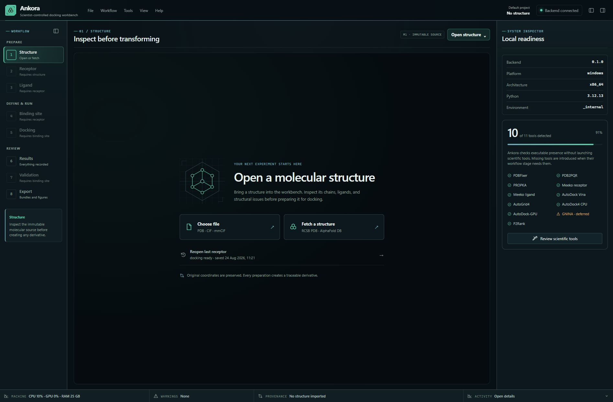

*Figure 1. All ten supported tools are detected in the isolated tutorial runtime. The eleventh entry is GNINA, explicitly deferred, not an installation failure. Executable discovery alone does not prove GPU compatibility.*

### The workbench

The window has three parts: the **workflow** on the left - eight numbered steps in three
groups, *Prepare*, *Define & run* and *Review* -
the **workspace** in the middle, and the **inspector** on the right. The status
bar at the bottom shows machine load, warnings, provenance and background
activity.

Steps unlock as their inputs exist. You cannot dock before there is a receptor,
a ligand and a box - not as a restriction, but because a docking run without
those is not a defined experiment.

On a laptop, use the panel-collapse buttons to give the workspace more room, or
drag a panel divider. **View** offers theme and density controls. Long interaction
reviews have a workspace scrollbar; wide tables have their own horizontal bar.
An off-screen **Save** control is not a disabled capability: scroll the workspace,
not the 3D canvas. Figure 2 shows the same shell with a structure loaded.

**Projects.** Use **File → Project workspace…** to create or switch projects.
Inputs, campaigns and exports belong to the selected project. Reopen a saved
receptor with **File → Reopen latest receptor**; this loads the accepted derivative
without rerunning preparation. The migrated `default` project remains a real
project, not disposable demonstration data.

---

## 3. Structure → Receptor: preparing 7AQF

### 3.1 Import the structure

Step **1 · Structure**. Choose **Fetch a structure** (RCSB PDB · AlphaFold DB),
choose **RCSB PDB**, enter `7AQF` and confirm. The same action is available in
**Open structure** and the **File** menu. For a local structure, choose a PDB,
CIF or mmCIF file instead. An AlphaFold accession is not a PDB ID and does not
provide a co-crystallized experimental ligand.

Ankora downloads the deposited mmCIF, hashes it, and inspects it **without
changing a single coordinate**. You should see:

| | |
|---|---|
| Method | X-RAY DIFFRACTION |
| Resolution | 1.77 Å |
| Models | 1 |
| Atoms | 6266 |
| Residues | 1218 |
| Missing residues | 22 |
| Missing atoms | 123 |

This file is now immutable. Everything from here on is a *derivative* that
points back at it by identity and hash.

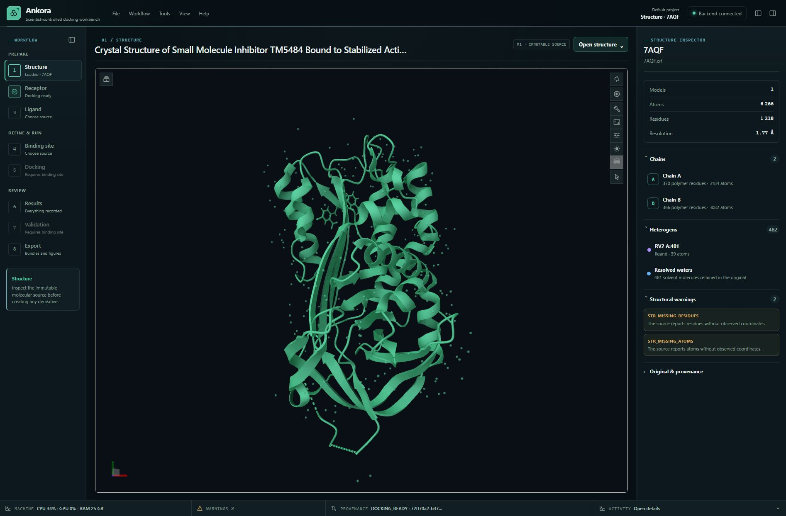

*Figure 2. The original 7AQF structure, with chains A and B, RV2 and waters. Metadata at right describes the whole imported entry, not the selected chain-A receptor. Deposited mmCIF SHA-256: `79fd3b96adca…`.*

### 3.2 Make the receptor

**Current development workflow — three guided steps.** The source interface now
opens in **Guided preparation**. This change is not yet in the previously
distributed private-beta installer. The accepted historical receptor and Figure
3 below remain unchanged; they are not a new-method validation result.

The original 7AQF all-17-repair plan now stops at ARG A:300's incompatible
observed coordinates (explained below). These steps describe how to review that
case, not a guaranteed one-click successful re-preparation.

1. **Choose system.** For this example, select chain **A**, remove resolved
   waters and remove **RV2 A:401**. A distance reference such as RV2 is optional:
   it highlights proximity, not a docking box. No chain, water or component is
   removed without your choice. Press **Next · review repairs**.
2. **Review repairs.** The grouped actions can mark the **17 incomplete side
   chains** for repair and keep the **9 absent-residue gaps unmodelled**. They
   populate the draft only. Review individual rows in the table, especially
   alternate conformations, unusual residues and anything near the site. No
   loop coordinates or residue deletions are inferred. Press **Next · hydrogens
   and preparation** when every issue has a resolved decision.
3. **Prepare.** Select **Prepare for docking**, choose the target pH (**7.4** in
   this example), and press **Analyze pKa proposals** above the viewer. Review
   **Needs attention** and use **All proposals** for the complete list; filtering
   never drops selected states. Confirm **I reviewed the system, repairs and
   selected protonation states**, then **Apply explicit preparation plan**.
   Editing the system, repair settings, pH or selected states requires a fresh
   confirmation; structural/pH edits also invalidate the previous pKa analysis.

For any receptor, **What to keep** is the authoritative component decision:
once you explicitly remove a component, its observations are excluded from
the repair table and no second residue decision is required. The source remains
unchanged. Retained incomplete components are identified separately; Ankora does
not offer amino-acid reconstruction for a ligand or metal-containing component.
Review its experimental role and use an appropriate preparation workflow when
needed; removal is never an automatic workaround. The final plan lists the
actual kept/removed components, not just a total. These general checks and their
limits are documented in [the workflow matrix](validation/GENERAL_RECEPTOR_WORKFLOW_2026-10-14.md).

New development plans also compare observed heavy-atom names with templates for
the 20 standard amino acids, even when a local file has no missing-atom headers.
The report does not infer hydrogens, terminal OXT or whole missing residues, and
it does not guarantee completeness of each alternate conformation. Review those
choices separately. Reopened historical records keep their original source-
reported inspection method; no old preparation is silently upgraded.

New requests explicitly record **Topology-guarded repair**, with fixed observed
atoms during reconstruction and connectivity/stereochemistry checks before
protonation. The separate optional elastic relaxation is off by default and
remains in **Advanced controls**, alongside the repair seed and legacy method.
Switching modes preserves your decisions. Reopening an older record preserves
its historical method; changing it creates another derivative, not an upgrade
of the old evidence. The bounded new-method 7AQF acceptance is documented in
[the repair validation record](validation/RECEPTOR_TOPOLOGY_GUARD_2026-10-14.md).
That record also explains a remaining source-coordinate conflict in **ARG
A:300**: its observed anchors are too far apart for the missing NE to connect
normally. The completed guard rejects the current all-17-repair plan before
protonation. Do not treat a preliminary Meeko-generated file as a validated
repair, delete the residue without justification, or silently move observed
atoms. This case needs a scientific decision about rebuilding the observed
side-chain segment under a separately explicit protocol.

**Historical tutorial plan.** The following settings and image describe the
previously accepted receptor used in the recorded docking examples. In
particular, its separate elastic relaxation was enabled; that is not a blanket
recommendation to enable relaxation for every new receptor.

Step **2 · Receptor**. Complete the explicit preparation plan before applying
it. The following describes this example, not a universal preparation recipe.

1. **Chains.** Keep **A** only.
2. **Waters.** Remove them.
3. **Components.** Remove `RV2 A:401` - the co-crystallized inhibitor. We will
   dock it back in later, so it must not be in the receptor.
4. **Structural issues.** Review each issue. The historical receptor repaired
   17 observed residues with missing heavy atoms; absent residues were not
   modelled. Use the recorded per-residue decisions to reproduce that plan,
   not a blanket removal of every warning.
5. **Repair and protonation.** For the selected repairs, enable restrained
   relaxation and protonation at **pH 7.4** with the **AMBER** force field.
   Resolve blocking issues, analyze the PROPKA proposals, review residue
   states and confirm the explicit protonation choices before applying. In the
   current UI, inspect the PROPKA proposals and any ambiguity warnings; a pH
   value alone is not a review of residue-specific states.

For the historical receptor used here, the complete chain-A issue decisions were:

| Action | Residues in chain A |
|---|---|
| Repair missing observed heavy atoms: LYS | 28, 80, 104, 288 |
| Repair: GLN | 107, 174, 257, 303, 312 |
| Repair: ASP | 231 |
| Repair: GLU | 244, 313, 350, 351 |
| Repair: ARG | 271, 300 |
| Repair: ILE | 342 |
| Leave absent residues unchanged | VAL 1; SER 336, 337, 338; VAL 343; SER 344; ALA 345; ARG 346; MET 347 |

These are **17 repaired residues and 9 absent-residue decisions**, not 26
removed residues. The original full-entry counts in §3.1 are a different scope.
Removing all problematic residues would change the protein and is not this plan.

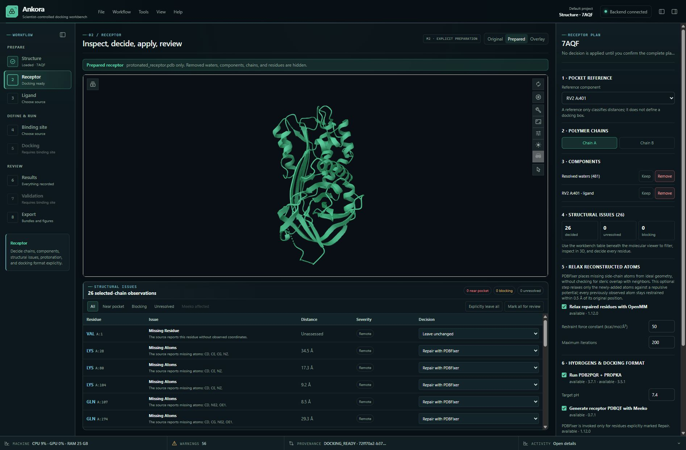

*Figure 3. The accepted historical receptor reopened in Prepared mode. Only chain A is present; 481 resolved waters and RV2 were removed from this derivative. Original mode retains them; Overlay compares both without modifying either record.*

Press **Apply explicit preparation plan**. Ankora runs, in order: PDBFixer for
explicitly selected repairs, a restrained OpenMM relaxation
(50.0 kcal mol⁻¹ Å⁻² positional restraint, at most 200 iterations), PDB2PQR with
PROPKA for protonation, and Meeko to write the PDBQT.

Watch the **Activity** centre: each tool reports its own version, and each output
is hashed as it is written. When it finishes the receptor is marked
`docking_ready`.

The accepted receptor predates the current expanded protonation-review UI. It
records PDB2PQR/PROPKA at pH 7.4 and the AMBER protocol, but must not be described
as evidence that the newer review controls were exercised. In this tutorial it
was **reopened**, not prepared again. Its measured maximum displacement of an
observed atom during relaxation was **0.38 Å**; the docking PDBQT hash begins
`83379bb5f78d…`.

If Meeko reports a connectivity or valence failure, inspect the identified
residues and the technical evidence. Ankora must not silently remove them for
you. An explicit **Repair**, **Remove** or **Leave unchanged** decision is part
of the scientific plan, and removal should be justified before retrying.

> **Why the relaxation is restrained.** Rebuilt side chains can clash. Relaxing
> without restraints could displace experimentally observed coordinates.
> Ankora restrains previously observed atoms; they are not perfectly frozen.
> It measures their largest displacement and enforces the configured drift
> limit. This is local clash relief, not molecular dynamics or equilibration.

---

## 4. Ligand: preparing RV2

Step **3 · Ligand**. Ankora can take a ligand from a file, a SMILES string, a
library - or, as here, **extract it from the crystal**.

### 4.1 Extract

Choose **From the imported structure**, select `RV2 A:401`. Ankora extracts it
with its deposited 3D coordinates and assigns stereochemistry from those
coordinates rather than guessing:

| | |
|---|---|
| Formula | C₁₉H₁₃ClN₂O₅ |
| Formal charge | 0 |
| Heavy atoms | 27 |
| Molecular weight | 384.78 g/mol |

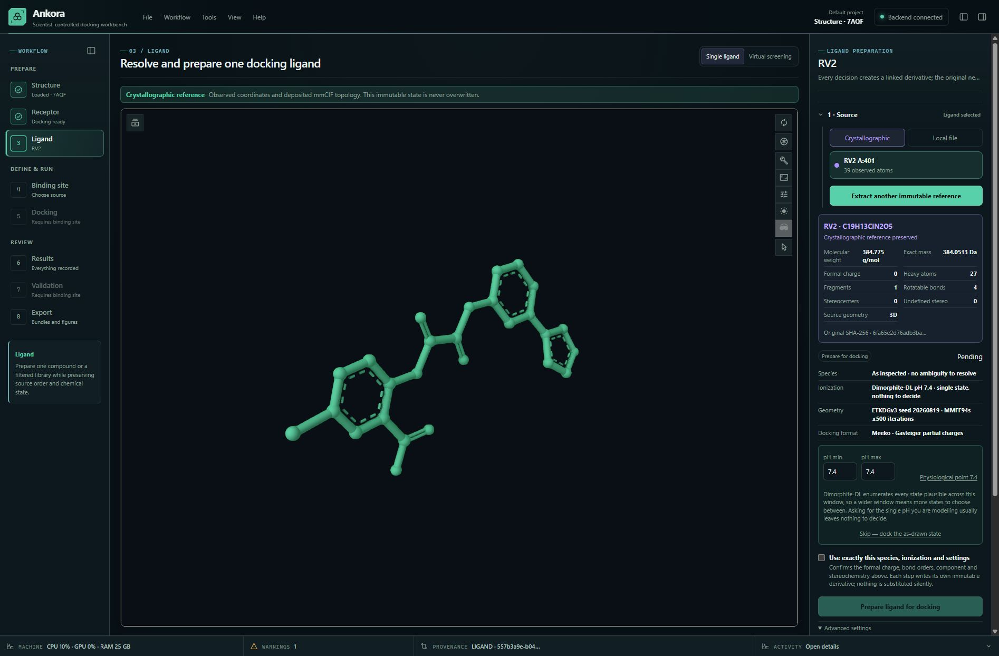

*Figure 4. Extracted RV2 with deposited geometry, neutral charge and molecular weight 384.775 g/mol. The preparation controls below describe a proposed derivative; they do not change the preserved reference.*

### 4.2 Choose a protonation state - explicitly

Protonation is a scientific choice, not just a file-format conversion.

In **Single ligand** mode, the preparation panel proposes ionization states for
the chosen pH range. Set both limits to **7.4**, inspect the candidate and any
warnings. Dimorphite-DL 2.0.2
returns one candidate for RV2 at that pH:

> **C₁₉H₁₂ClN₂O₅⁻**, formal charge **−1**

Ankora will not adopt it until you confirm. It is a different chemical state of
the same parent compound - different hydrogen-bond donors, different Meeko
atom typing, and in AutoDock4 a different electrostatic term. Confirm **Use these
exact species and ionization settings**. A candidate is not a measured population
or proof of the dominant bound state.

> **If you retain the imported state**, the neutral RV2 state is prepared.
> That is an explicit choice to justify scientifically, not evidence that the
> neutral state dominates at pH 7.4. The Methods section records it.

### 4.3 Generate and minimize a conformer

Open **Advanced options** and review the conformer protocol. For this tutorial,
leave **Minimize original geometry** off, use an independent pool of **20
ETKDGv3 conformers**, seed **20260819**, **MMFF94s**, at most **500 iterations**.
Press **Prepare ligand for docking**. The current single-ligand UI combines
the confirmed chemical-state, embedding, minimization and PDBQT stages; you do
not need three separate preparation buttons.

Recorded on 9 October with RDKit 2025.09.6:

| Check | Tutorial derivative |
|---|---|
| Formula / charge | C₁₉H₁₂ClN₂O₅⁻ / −1 |
| Molecular weight | 383.767 g/mol |
| Initial / final MMFF energy | 145.390 / 49.212 kcal/mol |
| MMFF energy change | −96.179 kcal/mol |
| Minimization | Converged |
| PDBQT preparation | Meeko 0.7.1, Gasteiger partial charges |

The energy change assesses **this molecule's geometry**, not binding affinity
and not its rank among other compounds. Values may change with a different
chemical state, conformer protocol or toolkit version.

The coordinates are generated **independently of the deposited ones**. This
matters for redocking: independent starting coordinates reduce bias from
reusing the reference geometry as the search input.

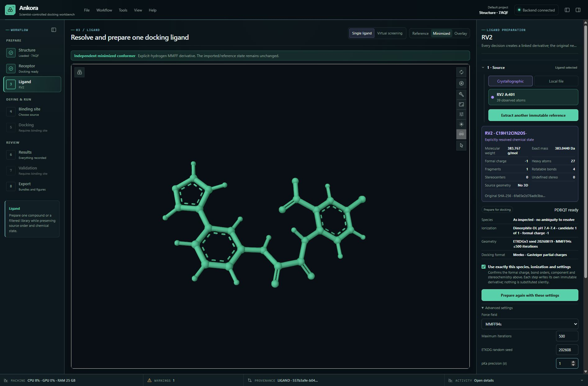

*Figure 5. Completed anionic derivative, its molecular weight and within-molecule MMFF energy change. The original/reference geometry remains independent; the derivative is ready as Meeko PDBQT.*

**Checkpoint.** Do not continue with a failed minimization, unresolved fragment
or undefined stereochemical decision. Inspect the status and warning, make the
required explicit choice and create a new derivative. For libraries, follow
[§12](#12-from-one-ligand-to-virtual-screening) rather than preparing only the
currently displayed row.

---

## 5. Binding site and docking

### 5.1 The box

Step **4 · Binding site** initially shows **Full protein (blind)**. That is a
starting box, **not** a final pocket selection. For this case choose
**Co-crystallized ligand**, pick `RV2 A:401`, set padding to **5.0 Å** and preview
the box from the component's observed coordinates:

| Centre (Å) | Size (Å) |
|---|---|
| 35.4305, −2.9670, −0.7905 | 21.597 × 19.870 × 19.317 |

The box is editable and shown live in the 3D viewer. Once confirmed it becomes
an immutable record - if you later change the receptor, every binding site that
depended on it is marked stale rather than silently reused.

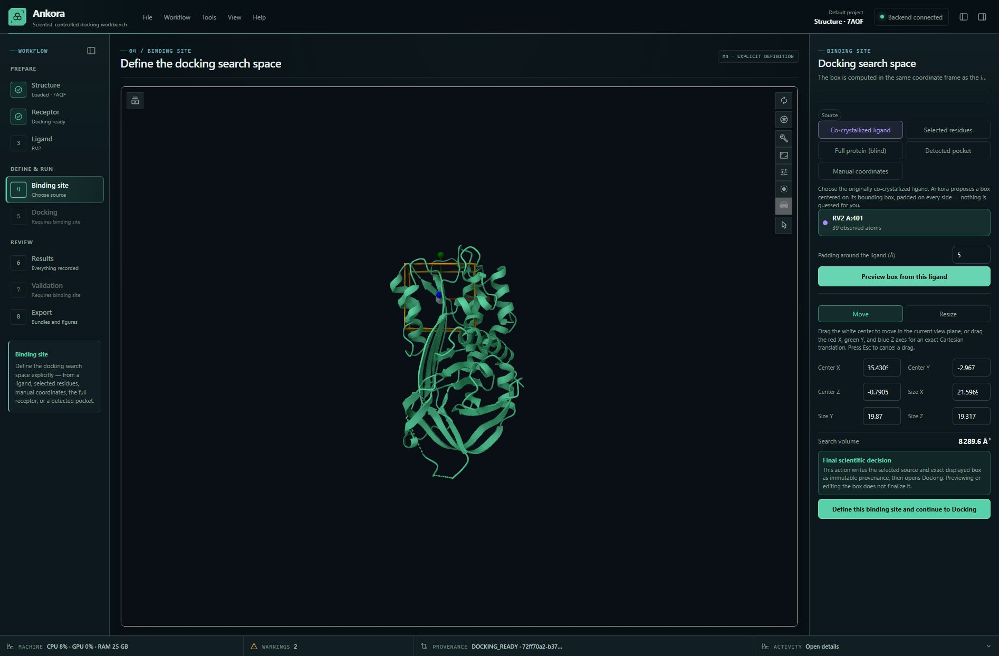

*Figure 6. Co-crystallized RV2 defines the preview box with 5 Å padding. Numeric coordinates and the Cartesian handles refer to the same receptor coordinate frame. Finalization, not just preview, creates the saved site.*

In **Move**, drag the white centre in the viewing plane, or an X/Y/Z handle for
an axis-constrained movement. In **Resize**, drag a face handle. Changes update
the box live; the numeric fields offer precise control. **Esc** cancels a drag.
Rotating the camera does not rotate the Cartesian docking box.

Choose the appropriate source for your experiment:

| Source | What you must decide |
|---|---|
| Co-crystallized ligand | Reference component and padding; useful for this redocking case |
| Selected residues | Explicit chain/residue selection and padding; review the preview extent |
| Full protein (blind) | Whole-receptor coverage, size and acknowledgement of a large search volume |
| Detected pocket | Run P2Rank, inspect candidates, choose a pocket, then adjust and confirm the box |
| Manual coordinates | Centre X/Y/Z and size X/Y/Z in Å, plus the rationale for that region |

P2Rank uses the bundled private Java runtime. Its candidates are computational
predictions, not experimentally confirmed sites. Selecting one positions an
editable box; it does not automatically start docking.

Press **Define this binding site and continue to Docking** when the preview is
correct. For manual adjustments use the equivalent final save action. Every
mode requires a final definition; navigating away from a preview is not saving
the experiment. The complete-protein box is much larger than this local box and
may require greater sampling, not just the local-box settings copied below.

### 5.2 Dock with Vina

Step **5 · Docking**. Choose **Single ligand** and **AutoDock Vina 1.2.7**.
Review the receptor, exact prepared ligand and finalized site. The light tutorial
used the **Screening** sampling preset with these explicitly recorded parameters:

| | |
|---|---|
| Exhaustiveness | 8 |
| Modes | 9 |
| Minimum inter-mode RMSD | 1.0 Å |
| Energy range | 3.0 kcal/mol |
| Seed | 20260823 |
| CPU threads | 1 - intentionally small for this single-ligand tutorial |
| Timeout | 360 minutes maximum, not an expected run duration |

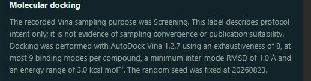

*Figure 7. The selected job's Methods report confirms exhaustiveness, modes, inter-mode RMSD, energy range and seed. CPU allocation and timeout remain in the full job record.*

Confirm the exact inputs and start docking. Screening progress is reported per
molecule; a single-ligand job reports its execution state rather than a
fabricated intra-molecule percentage. The run is cancellable, and if
the machine stops mid-run the next launch preserves the interrupted attempt
instead of pretending it never happened.

**New tutorial result: 9 poses, best Vina score −7.073 kcal/mol.** This run
completed in about 37 seconds on the tutorial machine; that is an observation,
not a performance promise. Scores for modes 1-9 were −7.073, −6.798, −6.715,
−6.652, −6.543, −6.526, −6.473, −6.294 and −6.245 kcal/mol.

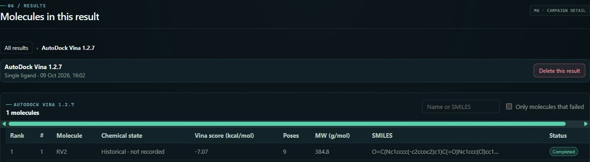

*Figure 8. The completed tutorial result contains one parent compound and nine preserved poses, with best score −7.07 kcal/mol. The parent-property/state-label caveat below is visible in this table; preparation evidence identifies the actual anionic docking input.*

**Important RMSD distinction.** Vina's lower/upper RMSD columns describe distance
from its best mode, not distance from crystallographic RV2. A zero in mode 1 is
not successful redocking. Reference-pose validation is a separate calculation.

**Parent versus prepared state.** A result table may show the imported parent's
name, formula or molecular weight. Here that parent is neutral RV2 (384.775
g/mol); the docked derivative is the confirmed anion (383.767 g/mol). Check the
preparation record and Methods report to identify the actual input, especially
where a historical table field is marked “not recorded”.

### 5.3 Optionally, the AutoDock4 family

AutoDock4 and AutoDock-GPU need precomputed affinity maps. Ankora runs AutoGrid4
once (0.375 Å spacing, 58 × 54 × 52 grid intervals for this box, with one more
node along each axis) and can **reuse a compatible map set** for both backends.
Reuse requires matching receptor, search geometry, atom types and map protocol.

The frozen historical examples used different ligand states:

| Engine | RV2 formal charge | Output | Best score (kcal/mol) |
|---|---|---|---|
| Vina 1.2.7 | -1 (anion) | 9 poses | -7.073 |
| AutoDock4 CPU 4.2.6 | 0 (neutral) | 10 runs | -4.96 |
| AutoDock-GPU 1.6 | -1 (anion) | 10 runs | -5.70 |

The CPU example did not use the anionic conformer prepared in §4. These records
illustrate interpretation; they are not a matched-input engine benchmark.

> **Do not combine these numbers.** A Vina score and an AutoDock4
> binding energy come from different scoring functions. Ankora will show them
> side by side and will never merge them into a combined ranking.

---

## 6. Validation: did the engine find the crystal pose?

This is the section worth reading twice.

Step **7 · Validation** compares a docked pose against the crystallographic
ligand using **symmetry-aware heavy-atom RMSD, computed in place** - the pose is
*not* superimposed first. Superimposing would measure whether the shapes match;
we want to know whether the atoms are where the crystal says they are.

> Aligning the ligand alone can hide an incorrect placement in the pocket.
> Ankora therefore evaluates placement in the receptor's coordinate frame.

### 6.1 Read a recorded validation

Choose **7 · Validation**, then select a recorded validation in the inspector.
Read its reference, threshold and per-pose RMSD table. The historical verdicts
below used the different chemical states listed in §5.3 and a recorded 2.0 Å
threshold. Neither this historical evidence set nor the new Vina tutorial
contains a Vina reference-RMSD verdict; a docking score cannot supply one.

> **Current beta UI limitation.** This workspace reviews saved validations;
> it does not yet expose a desktop control to create a new redocking-validation
> record. If your project has none, “No redocking validation recorded yet” is
> the correct state, not a successful validation. Do not look for a nonexistent
> “Run validation” button or substitute Vina's inter-mode RMSD. New-record
> creation exists in the backend and needs a future UI entry point.

| | AutoDock4 CPU | AutoDock-GPU |
|---|---|---|
| Top-ranked pose RMSD | **3.139 Å** | **10.717 Å** |
| Best pose found, any rank | 0.454 Å | 1.331 Å |
| First rank that recovers | 2 | 2 |
| Poses within threshold | 6 of 10 | 9 of 10 |
| Sampling | ✅ success | ✅ success |
| Ranking | ❌ **failure** | ❌ **failure** |
| Outcome | `recovered_but_misranked` | `recovered_but_misranked` |

**Read that carefully.** Both engines *found* the crystallographic pose - 0.45 Å
is an excellent reproduction. Both then ranked a wrong pose first. If you had
taken the top-ranked result and moved on, as most workflows invite you to do, you
would have carried a 3.1 Å (or 10.7 Å) pose into your interpretation.

Ankora separates **sampling** from **ranking** and reports both, because they
fail independently and they mean different things. A tool that reported only
"RMSD = 3.139 Å, failed" would have hidden the fact that the search worked and
the scoring function did not.

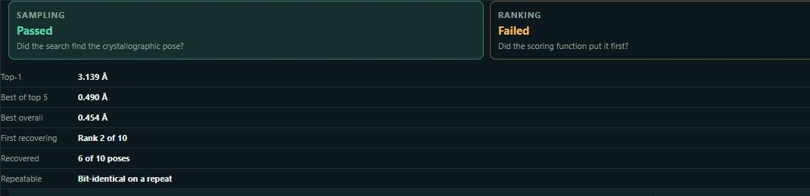

*Figure 9. Preserved AutoDock4 CPU/neutral-RV2 evidence: top-1 RMSD 3.139 Å, best of top five 0.490 Å, best overall 0.454 Å. Sampling passed; ranking failed. This is not a validation of the new anionic Vina job.*

> **On reproducibility.** A seed alone does not establish reproducibility.
> Read the exact-repeat evidence attached to the selected result. For example,
> the separate [6OCO/M5V validation](https://github.com/Olascoaga/Ankora/blob/main/docs/validation/PIK3CD_6OCO_M5V_EXECUTION.md)
> measured a 0.03 kcal/mol best-energy range across six GPU repeats and
> different cluster memberships. That observation is case-specific; it is not
> a universal GPU error bar or a guarantee of CPU bitwise identity elsewhere.

---

## 7. Results, interactions and figures

Step **6 · Results** lists recorded campaigns, including failed or interrupted
attempts, with each
engine, receptor, site and counts. Click a card to open its molecules; double-click
also opens it. In a molecule table, click the compound to reveal its poses or
AutoDock cluster/run members. Choose the exact mode or run you want to inspect.

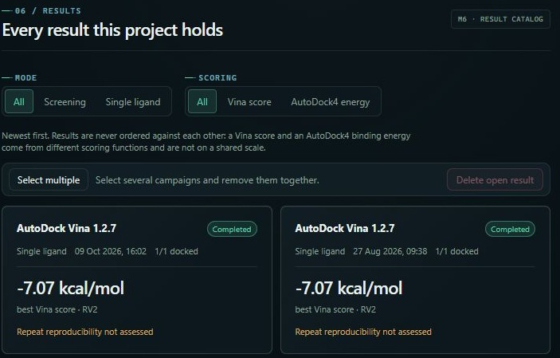

*Figure 10. The newest Vina card is the 9 October tutorial; the other visible Vina card is historical. The catalog is chronological, not a ranking across campaigns.*

Use the **Mode** and **Scoring** filters to locate results. Within a campaign,
search by name or SMILES, sort by column headings and use the horizontal scrollbar
to reach wide columns. Failed compounds remain visible and are not assigned a
successful docking energy.

To remove a result, use **Delete open result**. For a group, choose **Select
multiple**, select the exact cards, and review the confirmation. Campaigns and
their dependent interaction/validation records move to Ankora's recoverable
Trash; original structures, ligands, receptors and shared maps are not removed.
Removal from active Results is not an irreversible scientific-data purge.

### 7.1 Analyze the exact pose

Open **Pose interactions**, select **Mode 1** of the tutorial Vina job and press
**Analyze this pose with ProLIF**. ProLIF 2.2.1 runs over that exact pose against the exact
prepared receptor, under the recorded profile `ankora-default-v1` (6.0 Å vicinity
cutoff). The new Vina top-pose analysis has **17 atomic contacts, 5 contacting
residues and 8 residue/subtype groups**. The historical top-pose record also has
17 contacts but is a separate identity. Your own project starts without either
analysis: analyze its own exact pose, and do not assume the count is unchanged
after changing preparation, pose or versions.

You get three linked views of the same structured record - a 2D interaction
diagram drawn by Ankora, a contact table, and the pose in Mol* with the
contacting residues focused. Clicking a contact in one highlights it in the
others.

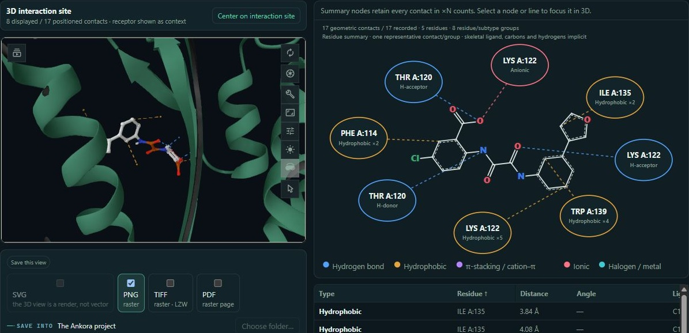

*Figure 11. One structured analysis feeds all three views. Summary mode displays 8 representative contacts from 17 positioned atomic contacts; the table retains all matching contacts.*

### 7.2 Read summary groups without losing contacts

**Residue summary** is the default. Each residue/exact interaction subtype has
one node, with **×N** for all its recorded atomic contacts. One shortest-distance
contact, or your selected contact, represents the group in 2D and 3D. Grouping
does not delete the underlying contacts.

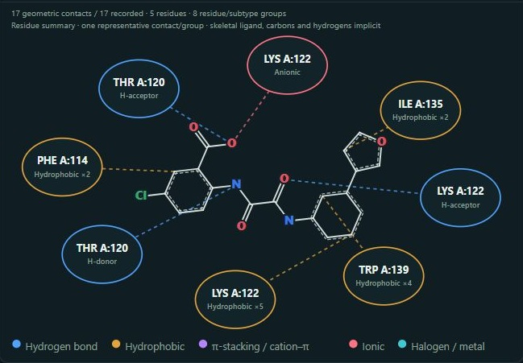

*Figure 12. THR A:120 has separate hydrogen-bond donor and acceptor groups. LYS A:122 has separate hydrophobic, acceptor and ionic groups. Colours are categories; exact subtypes are not merged just because they share a colour.*

**All atom contacts** shows every matching positioned contact instead. The
**Interaction type** menu filters the diagram, 3D lines and table together.
Read the numerator and denominator: filtered contacts versus all recorded
contacts. In this example, hydrophobic-only mode shows **13 / 17 contacts** in
**4 residue/subtype groups**; all-atomic mode displays all 13 lines.

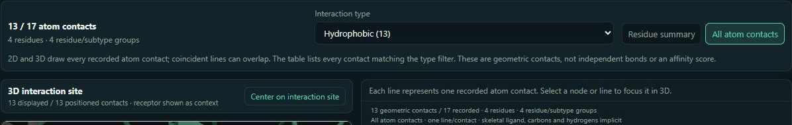

*Figure 13. Hydrophobic-only mode selects 13 of 17 contacts in 4 groups. The 3D heading confirms 13 displayed / 13 positioned contacts in all-atomic mode. These are not 13 independent bonds or favourable energetic contributions.*

Click a node or table contact to focus it in 3D. **Center on interaction site**
returns to the pocket; **Reset Zoom** may show the whole receptor. Summary can
make a dense first pose readable, while all-atomic detail supports inspection.
If a historical contact lacks 3D endpoints, it remains in the table and 2D
record with a visible notice; it must not be silently discarded.

### 7.3 Save the diagram, 3D view and coordinate complex

From here you can save the 2D diagram as SVG, PNG, TIFF or PDF; the 3D view
supports PNG, TIFF or PDF, not SVG. You can also export the
exact ligand-receptor complex as a PDB for other viewers. You choose the
destination folder; Ankora never overwrites an existing file, and suffixes a
taken name the way Windows does. The desktop **Choose folder…** selects a work
directory. **Use the project** writes to the selected project's exports area.
The browser-only capture environment cannot open the native folder chooser;
the project destination was used and verified for this tutorial.

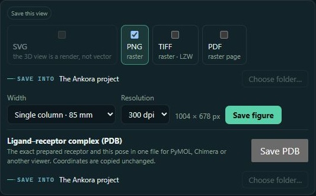

*Figure 14. 3D supports raster output, not SVG. The separate Save PDB button in the ligand-receptor complex panel writes coordinates, not HTML, and does not rerun docking.*

The PDB contains the exact prepared receptor plus the selected pose, without
minimization or superposition. It is suitable for inspecting coordinates in an
external molecular viewer; it is not a replacement for a chemically rich SDF
or a record of Meeko partial charges. In the tutorial, the file
`ligand_receptor_complex.pdb` was actually written, **480,421 bytes**, hash
`b9f17aba7bdc…`, with a neighbouring `complex.json` identity record.

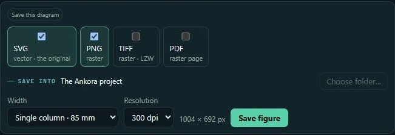

*Figure 15. The 2D save panel: SVG is the vector original; PNG, TIFF and PDF are raster alternatives. An 85 mm figure at 300 dpi was saved as 1004 × 692 pixels in the tutorial.*

1. Choose the formats you need. Use **SVG** for editable vector 2D artwork;
   use raster formats for the 3D rendering.
2. Choose the destination, width and resolution. These control the output,
   not the scientific calculation.
3. Press **Save figure**, wait for confirmation and inspect the written file.
4. For the complex, press **Save PDB** in the ligand-receptor complex panel.
   A saved figure does not automatically save molecular coordinates.

Saved diagrams preserve the selected summary/all-contact mode and counts.
Scroll the **workspace** to reach the saving controls on a laptop. The contact
table's horizontal/vertical bars only move its data, not the whole page.

> **What an interaction diagram is.** It is a geometric interpretation of one
> pose. It is not experimental evidence, not an energy decomposition, and not
> proof that a contact is favourable.

---

## 8. The Methods section

In **6 · Results**, select your result and use **Write the Methods section**
in its inspector. This also supports the single-ligand example. For screening
campaigns, the same report is available in **8 · Export**.

Choose the result whose protocol you intend to describe. A report for a
323-compound screening library is not the Methods section for this single RV2
job, even if both use 7AQF.

Ankora reads the provenance chain and writes the Methods text the campaign's own
records support - the PDB entry and its resolution, the chains kept, the repair
and relaxation parameters with the measured maximum displacement, the pH and
force field, the box centre and dimensions, the embedding and minimization
protocol, the charge model, the complete engine parameters, the executable's
SHA-256, and the counts.

Three things about that text are worth noticing.

**It marks what it cannot support.** A missing artifact becomes a visible
`[not recorded: …]` marker in the prose and an entry in the gap list shown above
it. It is never replaced by a plausible sentence.

**It states what was not done.** If no pH-based protonation enumeration was
recorded, the text says so explicitly. Your receptor section will name a pH; if
the ligand section stayed silent a reader would reasonably assume the same pH
applied. That silence would flatter the work, so Ankora breaks it.

**It carries the references.** The Software table lists every tool, its version,
its role and a numbered reference from Ankora's recorded bibliography. Review
these citations and the Methods text before including them in a manuscript.

Press **Copy to clipboard** and paste into your manuscript. What you get is the
Markdown source, headings and table included.

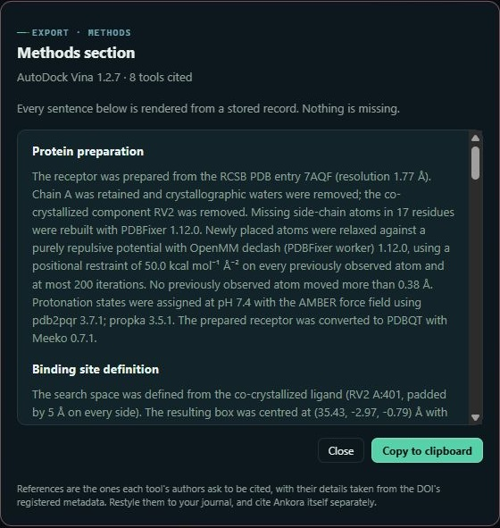

*Figure 16. The tutorial's actual Methods report: no provenance gaps reported, eight cited software entries. The visible receptor paragraph and start of the box section derive from the selected job's provenance chain; the report also records the ligand protocol.*

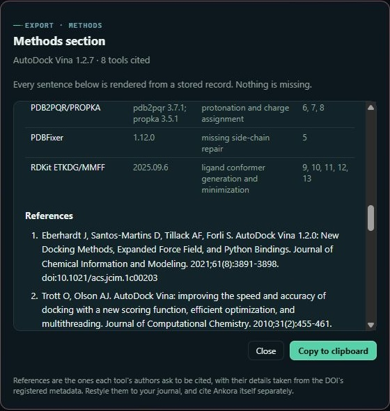

*Figure 17. Lower software-table rows and the beginning of the numbered references, with the copy control. Review tool-versus-worker version labels and citations before publication; a gap-free report still needs scientific editorial review.*

The **campaign bundle** (also in step 8) is the portable version of the same
idea: a ZIP with the manifest, results table, existing interaction analyses and
saved figures where available, and an integrity index. Inspect the bundle's
file list before using it as supplementary material; it is not a promise to
include every raw pose from a campaign. Export the exact pose complex when
you need that coordinate file.

Step **8 · Export** also catalogs existing figures and coordinate complexes.
Use **All**, **Campaign bundles**, **Figures** or **Complexes** to find the
artifact you need. The current **Bundle a campaign** chooser is for completed
screening campaigns: a single-ligand job can have saved figures/complexes without
appearing in that chooser. Its Methods report remains available in Results.

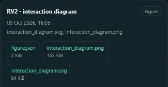

*Figure 18. The Export catalog exposes the real SVG, PNG and figure manifest saved for RV2. The destination-path line is deliberately outside this crop; this edition contains no personal machine paths.*

Before sending a bundle to collaborators, inspect the integrity index, file
list and any remaining missing-evidence notices. Share the specific output
directory, not an entire personal project folder with unrelated experiments.

---

## 9. What Ankora will not do for you

This list is the product, not a disclaimer.

- **It will not choose a protonation state silently.** If you do not enumerate,
  the imported state is used and the Methods text says so.
- **It will not enumerate tautomers unless you ask.** Tautomer enumeration is
  available for screening microstates and is off by default; when it is off, the
  Methods text records that too.
- **It will not merge scores from different engines.** No combined ranking, no
  consensus score.
- **It will not call a score an affinity**, or claim a biological result.
- **It will not rank the candidate protonation or tautomer states it generates.**
  Neither Dimorphite-DL nor RDKit provides a population model that would justify
  reading the order as a preference, so the order is reported as unranked.
- **It will not modify your imported file**, ever.
- **It will not quietly reuse a stale derivative.** Change a receptor and
  everything downstream is marked stale.
- **It will not claim reproducibility it did not measure.** A campaign with no
  exact repeat reports "not assessed" - which is different from "not
  reproducible".

---

## 10. How to read a docking score

A short section, because this is where results get over-interpreted.

A Vina score and an AutoDock4 binding energy are **computational estimates from
empirical scoring functions**, reported in kcal/mol. They are not measured
binding affinities and they do not convert to one. The number's useful job is
*rank-ordering ligands against one target*; it is much weaker at comparing
across targets, and it is not a prediction of activity.

§6 is the concrete lesson: on this system the scoring function ranked a 3.1 Å
pose above a 0.45 Å one. Sampling and scoring are different problems and they
fail separately.

Practical consequences:

- Do not compare a Vina score to an AutoDock4 binding energy.
- Do not read small differences between ligands as meaningful ordering.
- Inspect poses. A good score on a chemically implausible pose is a scoring
  artifact, and the interaction view exists to make that visible.
- Where a co-crystal exists, redock it first (§6). If the engine cannot rank the
  known pose first on your target, treat its ranking on unknown ligands with
  matching scepticism.

---

## 11. If something goes wrong

| Symptom | What it means |
|---|---|
| **Tools missing** | Open Tools → Scientific tool readiness and rescan. Report missing tools in a complete-installer candidate as an installation defect, not a request to configure paths yourself. Earlier backend-only candidates are incomplete. |
| **A step is greyed out** | Its inputs do not exist yet. The workflow panel names what is missing. |
| **"stale" badge on a derivative** | Something upstream changed. Recreate it; Ankora will not silently reuse it. |
| **A run was interrupted** | The next launch preserves the partial attempt as an explicit interrupted record. Retrying starts a new identity rather than appending to partial evidence. |
| **Port 8765 in use** | Another local process owns the port. Close a previous Ankora session if it is yours; do not terminate an unidentified process. |
| **Warnings badge is lit** | Read each finding and its required action. Some need a scientific decision; a preparation blocker cannot be ignored. |
| **A preparation is queued with low CPU use** | Inspect Activity and machine resources. The scheduler admits work only when CPU, GPU, memory and disk reservations fit; low CPU use is not evidence that multicore execution is disabled. |
| **Molecule absent from 3D** | Read the viewer error first. A downloaded record can exist even when the renderer fails. Report a CSP/module error as a software defect; do not change chemical preparation to fix a rendering problem. |
| **Many 3D lines but fewer 2D nodes** | Read atomic-contact and group counts, the interaction-type filter, and summary/all-atomic mode (§7.2). Multiplicities preserve contacts; nodes are not individual atom pairs. |
| **A save control seems missing on a laptop** | Scroll the workspace and collapse or resize panels. Scrollbars inside the contact table do not move the export panels. |
| **No validation is listed** | No validation record exists in this project. The current UI reviews records rather than creating new ones (§6.1). |

Logs live beside the project data; the **Provenance** panel in the status bar
shows every command Ankora issued, with its arguments.

For a report, include Ankora version, engine/tool versions, the affected step,
the error text, and whether this was a new or reopened project. Provide a
minimal non-confidential example where possible. Check screenshots and logs for
personal paths or unrelated compounds before sharing them.

---

## 12. From one ligand to virtual screening

The 7AQF/RV2 tutorial is a **single-ligand** run. Screening reuses the explicit
7AQF receptor and finalized box but processes a selected library, not just the
molecule currently visible in Mol*. The 323-record library used to inspect the
controls below is an existing illustrative import; **no new 323-compound
screening campaign or performance benchmark was run for this guide**.

### 12.1 Import, inspect and filter before 3D preparation

1. In **3 · Ligand**, switch to **Virtual screening**.
2. Open a multi-record **SDF**, **SD-style MOL**, **SMI** or **SMILES** file,
   or reopen an imported library under **Already in this project**. Current
   limits are **10,000 records** and **100 MB** per import. Multiple molecules
   in a MOL input need actual SD-style record delimiters, not concatenated
   undelimited MOL blocks.
3. Inspect import counts, invalid records, names, formulae, molecular weights
   and SMILES. Source order and failed-record evidence remain traceable.
4. Review **Library filters** and press **Preview filters** when available.
   Preview calculates descriptors and decisions; it does not apply the selection.
5. Inspect exclusions and flagged compounds. Confirm **Apply this exact
   selection**, then **Apply filtered subset**. This creates an immutable
   selection manifest including properties, rule results, exclusions and IDs.

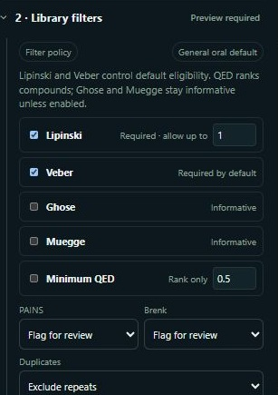

*Figure 19. Real controls from the illustrative 323-record import. Lipinski and Veber are required by default; Ghose/Muegge are informative, QED is rank-only, PAINS/Brenk flag for review, and duplicate repeats are excluded. This is a policy preview, not a completed filtering result.*

| Control | Default role | What to consider before changing it |
|---|---|---|
| Lipinski | Required; up to one violation | A general oral-drug heuristic, not a universal definition of a useful ligand |
| Veber | Required | Permeability-related heuristic; adapt the policy to the research question |
| Ghose / Muegge | Informative until enabled | Enabling all rules can exclude useful chemical space; review why |
| QED | Ranking descriptor; minimum filter off | A numerical desirability descriptor, not biological activity |
| PAINS / Brenk | Flag for review | Alerts require scrutiny; a substructure match is not proof of assay interference |
| Duplicates | Exclude repeats | Inspect the recorded identity policy; don't mistake source names for chemical identity |
| Custom rules | Explicit required/informative choice | Record descriptor, comparison and cutoff; keep the rationale |

These defaults are a starting policy, not a scientific claim that every library
should be screened through all five drug-likeness filters. Structural alerts
can be reviewed again among hits after docking; a docking score does not make
an alert disappear. The implemented alert label is **Brenk**, not “BREAKS”.

### 12.2 Prepare the applied subset

Confirm **Prepare the applied filtered subset** and process the selected ligands.
Review disconnected components, stereochemistry and failed molecules rather
than silently selecting a fragment or inventing a stereoisomer.

Screening microstate handling is an explicit choice: retain the exact supplied
state, or request bounded protonation/tautomer candidates and select the policy.
Tautomer enumeration is off by default. Candidate order is **unranked** and does
not predict populations. Changing a molecule's state also changes the actual
prepared chemical input; retain the parent/derivative link when interpreting
properties or results.

Independent ETKDGv3 geometry, MMFF minimization and Meeko PDBQT preparation run
per selected molecule. Their statuses update independently; one failure should
not erase its neighbours. **MMFF energy and ΔE are within-molecule geometry QC,
not a cross-molecule ranking.** Use the library search, sortable headers,
column chooser and horizontal scrollbar to inspect the complete table.

### 12.3 Dock the library and follow live progress

In **5 · Docking**, choose **Virtual screening**, the **applied prepared
selection**, the exact site and one engine. The run confirmation must name
the number of ligands to be docked. Selecting a row for viewing is not selecting
the entire library for docking.

For Vina, set an explicit **Total CPU threads** budget and **Concurrent ligands**.
The budget is divided among concurrent Vina processes; it is not multiplied
by giving every process the entire budget. For example, a 15-thread budget
with 15 concurrent ligands allocates one thread to each. This is an illustrative
configuration, not a measured speed-up or a required setting for your machine.

The progress strip reports **completed / running / queued / succeeded / failed**.
Finished compounds appear incrementally in the sortable results table. The
current-best banner identifies the lowest score **within that campaign**;
it does not claim measured affinity or compare unrelated engines. Click a
compound to open its poses, then inspect one exact pose in Results (§7).

CPU percentage depends on admitted work, search settings, memory and other
software. For GPU runs, inspect device compatibility and the recorded protocol;
CPU and GPU percentages are not interchangeable evidence of throughput.
Preserve partial failures and interruptions, then export the completed campaign
and its Methods report (§8). A redocking tutorial is not prospective
virtual-screening validation.

---

## Citing Ankora

If Ankora contributed to published work, cite it using the metadata in
`CITATION.cff` at the repository root, naming the version that produced your
results. Cite the scientific tools separately - the Methods section Ankora
generates lists them with their references.

## Telling us what is wrong

This guide and the software are both early. The most useful thing you can send
back is the point at which you stopped, and why.

---

*Ankora 0.1.0 · MIT licence · github.com/Olascoaga/Ankora*
